# ملف الأحداث بالتاريخ — التنفيذ 870/2024/204 والعريضة 2790/2025/56

نسخة كاملة من محتوى الويب أب: كل حدث بتاريخه، وما ادّعته طالبة التنفيذ، والثابت بالمستند، وقرار المحكمة، وتحته صور المستندات المقصوصة ومصدر كل صورة (اسم الملف والصفحة). مرتب من أول حدث إلى 2026.

## الأرقام

- **12** أمراً مقيداً للحرية صدر ضده — 8 ضبط وإحضار + 4 منع سفر — بوابة محاكم دبي، «جميع الأوامر المقيدة للحريات»
- **39** طلباً ذكياً منها فيه «الضبط والإحضار» — في التنفيذ 870: 17 في 2024، 18 في 2025، 4 في 2026 — من نص كل طلب في ملف الـPDF. وفي العريضة 2790: 9 طلبات.
- **15** مرة «راتبه 50 ألف» — وراتبه خُفِّض إلى 25 ألف من يوليو 2024 بخطاب جهة العمل الذي قدّمه للقاضي، ثم انتهت خدمته 30/04/2025.
- **4** أوامر إحضار «لعدم سداد مبلغ 0» — 23/10/2024 — 28/12/2024 — 09/02/2025 — 08/12/2025: نص الأمر نفسه.

## 2023

### 1. 04/11/2023 — بخطها: «كان يقوم بالدفع بانتظام»  
*إثبات قوي*

- **الثابت بالمستند:** لائحة عريضتها 3817/2023: «إلى تاريخ 31/08/2023 كان يقوم بالدفع بانتظام» — إقرارها المكتوب أمام المحكمة.

**لائحة طالبة التنفيذ في العريضة 3817/2023 (04/11/2023): «كان يقوم بالدفع بانتظام»**  
المصدر: أضرب/الصحيفة.pdf، ص1

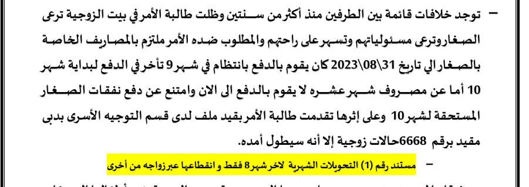

---
### 2. 26/12/2023 – 10/01/2024 — أول منع سفر وأول أمر إحضار — ثم رُفعا  
*إثبات متوسط*

- **ادّعت:** العريضة 3817/2023.
- **المحكمة:** منع سفر 26/12/2023 (رُفع 10/01/2024)، أمر إحضار 09/01/2024 (أُلغي 10/01/2024).

**بوابة محاكم دبي — «جميع الأوامر المقيدة للحريات»: 12 أمراً**  
المصدر: Request 2/Screenshot 2026-10-29 at 5.46.30 PM.png

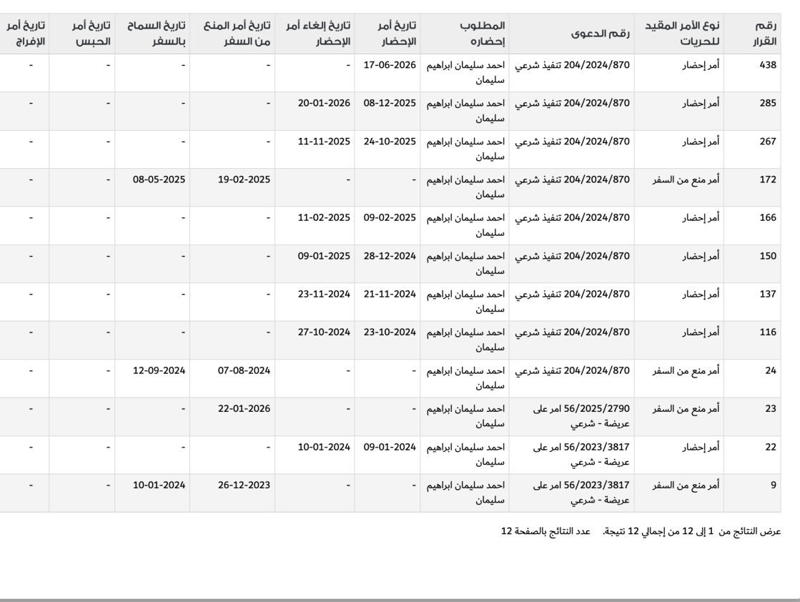

---

## 2024

### 3. 04/04/2024 — أمام المحكمة: «الأبناء لديهم تأمين صحي… وتم عمله من قبل المدعى عليه»  
*إثبات قوي*

- **الثابت بالمستند:** قولها هي في محضر الجلسة. وحكم 23/05/2024 نصّ على «الاستمرار» في استخراج بطاقة التأمين — أي أن التأمين قائم أصلاً.

**محضر جلسة 04/04/2024 — إقرار المدعية بأن للأبناء تأميناً صحياً عمله المدعى عليه**  
المصدر: 24-04-04 المحكمة ملف أحوال 397-2024 3.pdf، ص1 — ملف القضية 870/الدعاوى المرتبطة/أحوال 397-2024

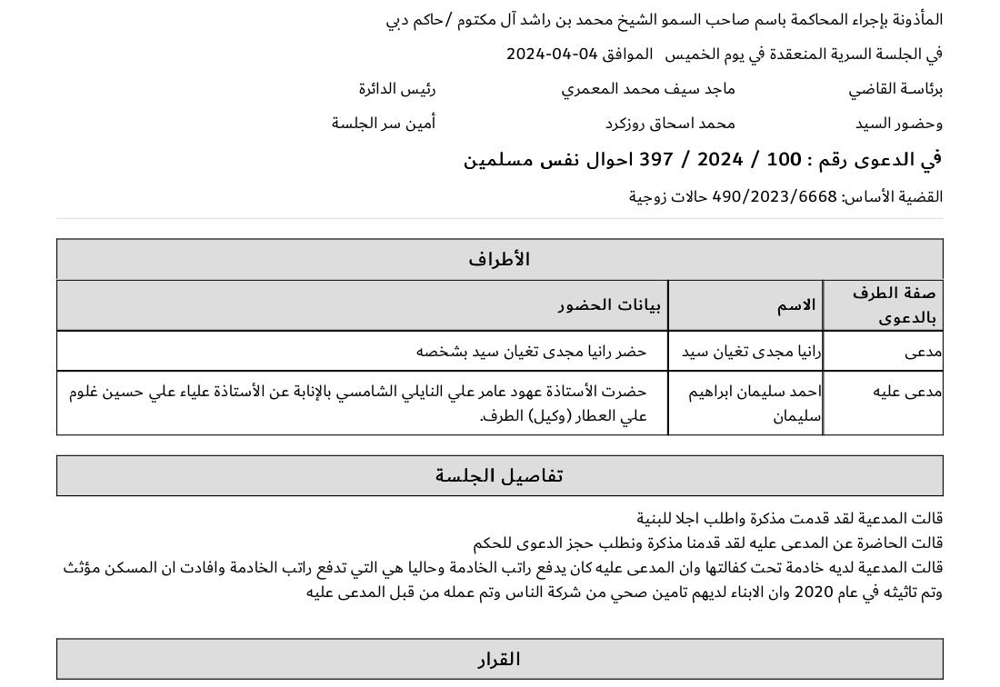

**منطوق حكم 397/2024 (23/05/2024) — البند 7: «الزامه الاستمرار باستخراج بطاقة تأمين صحي»**  
المصدر: أضرب/حكم المحكمه .pdf، ص2

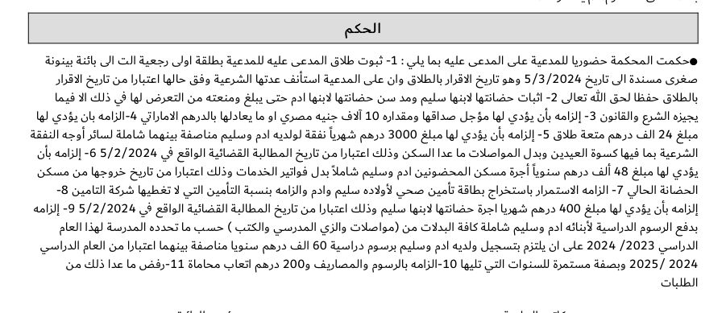

---
### 4. 07/05/2024 — جهة العمل تخفّض راتبه إلى 25,000 من 1 يوليو 2024  
*إثبات قوي*

- **الثابت بالمستند:** خطاب FinMark: «from AED 50,000 to AED 25,000 effective 1st July 2024… in consideration of your medical needs». قدّمه أحمد للقاضي في الطلبات 30 و121 و128.

**FinMark Capital — 07/05/2024: الراتب من 50,000 إلى 25,000 اعتباراً من 1 يوليو 2024**  
المصدر: 24-08-07 أحمد شهاده راتب 66097-2024-6.pdf — ملف القضية 870/المنع من السفر - المرفقات

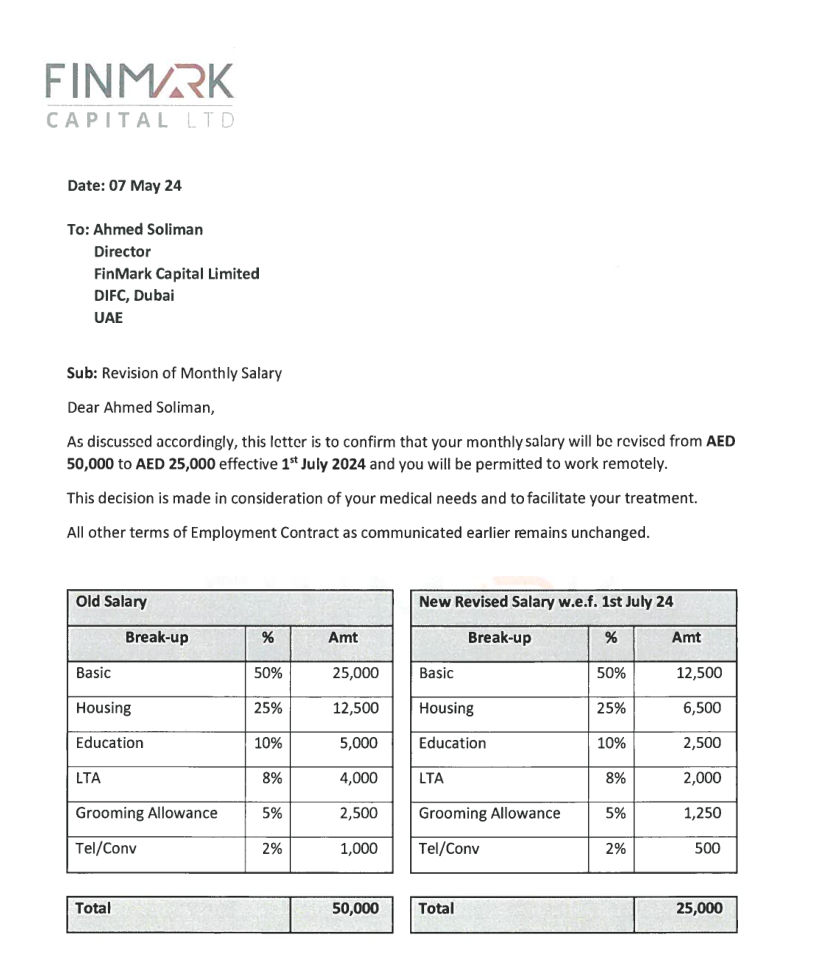

---
### 5. 27/07 – 10/08/2024 — «مرفق شهادة راتب 50 ألف» — والمرفق خطاب عدم ممانعة سفر من 2023  
*إثبات قوي*

- **ادّعت:** الطلبات 11 و18 و33: «تم ثبوت يسار المنفذ ضده مرفق شهادة راتب بمبلغ 50 الف شهرياً».
- **الثابت بالمستند:** المرفق المسمّى «شهادة راتب» هو خطاب عدم ممانعة لسفارة بريطانيا مؤرخ 22/05/2023 (الطلب 33، ص6) — قبل الطلب بأكثر من سنة، وقبل خفض الراتب.

**الطلب رقم 18 وقرار القاضي عليه — التنفيذ 870/2024/204**  
المصدر: 24-08-05 رانيا تنفيذ المنطوق إخطار 18.pdf، ص11 — ملف القضية 870/الطلبات الذكية

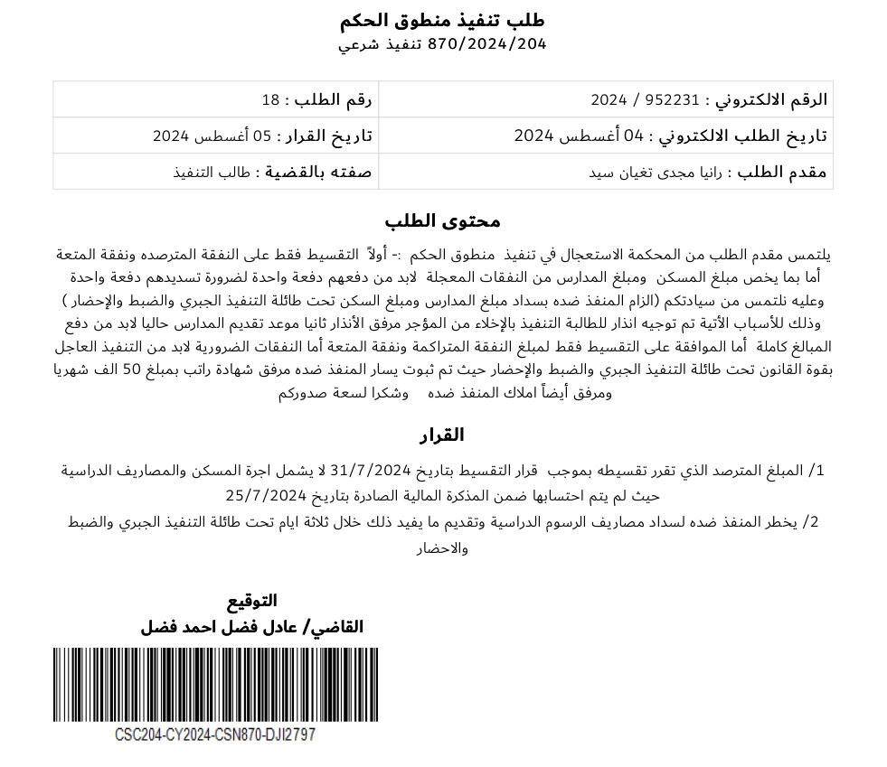

**خطاب عدم ممانعة سفر لسفارة بريطانيا — 22/05/2023**  
المصدر: 24-08-10 رانيا تنفيذ المنطوق استيفاء 33.pdf، ص6 — ملف القضية 870/الطلبات الذكية

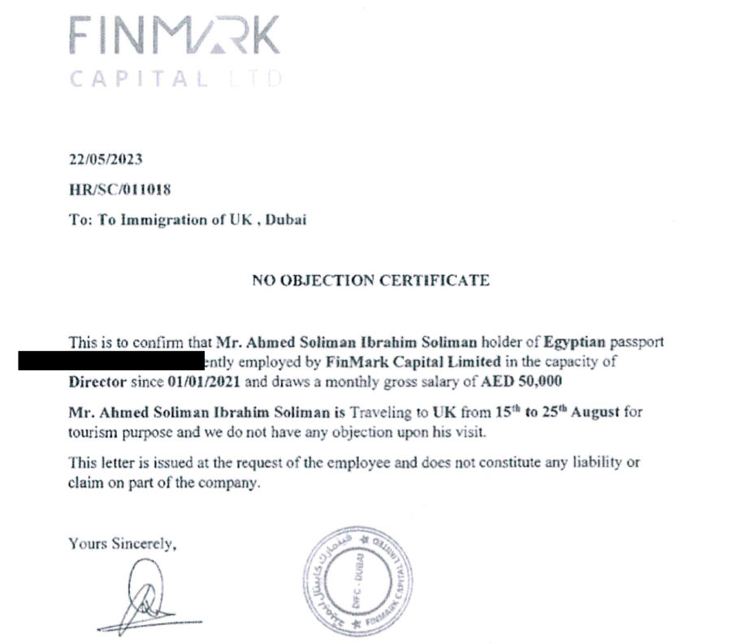

---
### 6. 29/07 – 31/07/2024 — يسدّد 16,150 فوراً  
*إثبات معتاد*

- **الثابت بالمستند:** إيصال المحكمة 29/07/2024.
- **المحكمة:** قرار 31/07/2024 على طلب التقسيط 12: «ثبوت سداد دفعة من المترصد قبل يومين… نصرح بتقسيط المبلغ المتبقي».

**طلب التقسيط 12 وقرار 31/07/2024: «ثبوت سداد دفعة من المترصد قبل يومين… نصرح بتقسيط المبلغ المتبقي»**  
المصدر: 24-07-30 نصر طلب تقسيط موافقة 12.pdf — ملف القضية 870/الطلبات الذكية

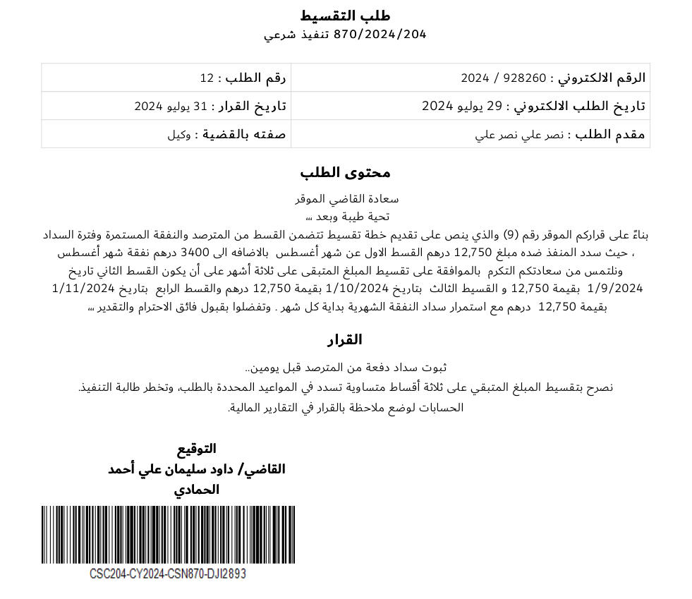

---
### 7. 07/08/2024 — منع السفر الأول في التنفيذ — المرفق الوحيد صورة هويته  
*إثبات قوي*

- **ادّعت:** طلب منع السفر 66000/2024: «المنفذ ضده يود الهرب خارج الدولة» (بيانات الطلب على البوابة).
- **الثابت بالمستند:** نفس اليوم، طلب أحمد 30: «طالبة التنفيذ تضغط علي بكثرة الطلبات وادعاءات منع السفر والحجز على الحسابات البنكية… وتدعي أنني أملك أموالاً طائلة، في حين أن دخلي الشهري هو 25 ألف درهم». والمدرسة: «Tuition fee has been fully paid».
- **المحكمة:** صدر المنع بشرط كفالة 150,000. وعلى طلب أحمد: «الطلب مكرر».

**أمر منع السفر 07/08/2024 — كفالة 150,000**  
المصدر: 24-08-07 المحكمة القرار 66000-2024-9.pdf — ملف القضية 870/المنع من السفر - المرفقات

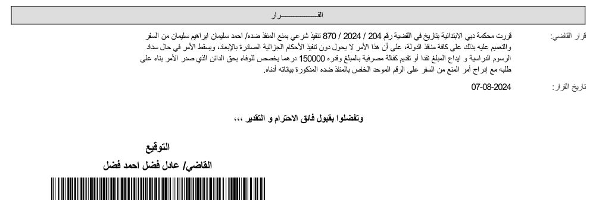

**طلب أحمد 30 (07/08/2024) وقرار القاضي**  
المصدر: 24-08-09 أحمد مقابلة القاضي مكرر 30.pdf، ص12–13 — ملف القضية 870/الطلبات الذكية

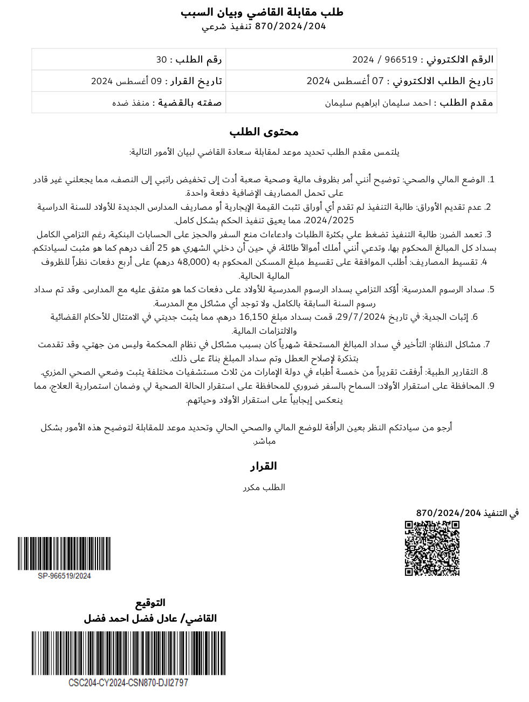

---
### 8. 22/08/2024 — «المنع استند إلى 150 ألف غير موجودة في أي مذكرة»  
*إثبات متوسط*

- **الثابت بالمستند:** طلب أحمد 64: «قرار التعميم بمنعي من السفر تم استناداً إلى مبلغ 150 ألف درهم، وهو مبلغ غير موجود في أي من المذكرات الحسابية». وفي اليوم نفسه أمرت المحكمة بوقف الإجراءات وإلغاء الحجوزات البنكية (الطلب 52).
- **المحكمة:** على الطلب 64: «لسداد الرسوم الدراسية للعام 2024-2025».

**طلب أحمد 64 (22/08/2024) وقرار القاضي**  
المصدر: 24-08-29 أحمد مقابلة القاضي إخطار 64.pdf، ص5–6 — ملف القضية 870/الطلبات الذكية

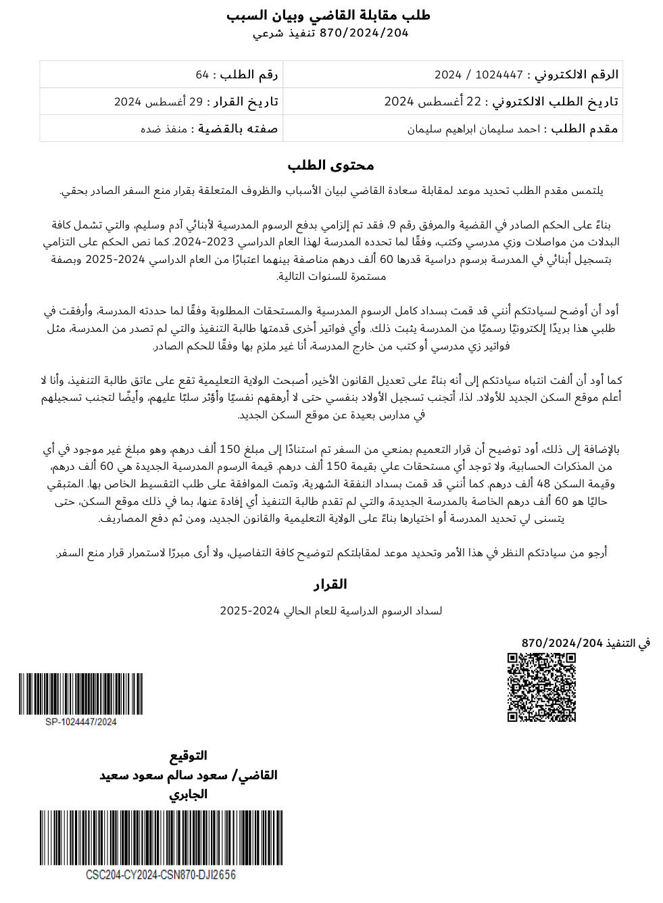

**طلب أحمد 52 وقرار 22/08/2024: وقف الإجراءات وإلغاء الحجوزات البنكية**  
المصدر: 24-08-21 أحمد وقف الإجراءات موافقة 52.pdf، ص6 — ملف القضية 870/الطلبات الذكية

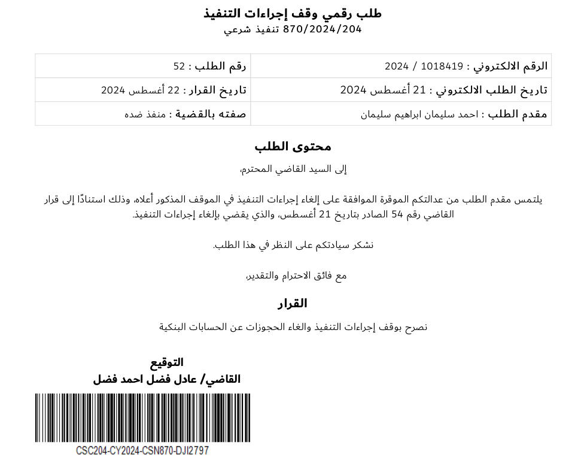

---
### 9. 13/09 – 14/09/2024 — المحكمة نفسها: «لعدم ثبوت الخشية من هروبه»  
*إثبات قوي*

- **ادّعت:** الطلب 75: «منع سفر المنفذ ضده خوفاً من هربه».
- **المحكمة:** «رفض المنع من السفر لعدم ثبوت الخشية من هروبه».

**الطلب رقم 75 وقرار القاضي عليه — التنفيذ 870/2024/204**  
المصدر: 24-09-13 رانيا مقابلة القاضي جزئي 75.pdf، ص2–3 — ملف القضية 870/الطلبات الذكية

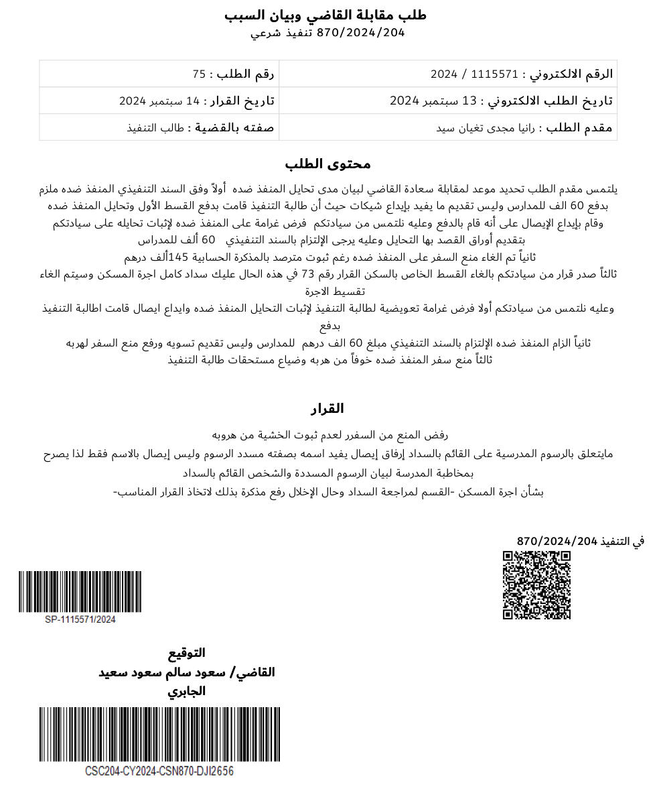

---
### 10. 19/09/2024 — تتّهمه بتقديم «مستند مزور» — وهو قدّم شيكات المدرسة  
*إثبات متوسط*

- **ادّعت:** الطلب 86: «المنفذ ضده قدم مستند مزور أنه قام بسداد مصاريف المدرسية القسط الأول… نلتمس… تحت طائلة الضبط والإحضار والتنفيذ الجبري».
- **الثابت بالمستند:** لم يدّعِ أحمد سداد الفصل الأول؛ قدّم شيكَي المدرسة 18,794 و18,309 عن الفصلين التاليين، وأثبت تقرير الخبير خصم 37,103 من حسابه. وأكّد للمحكمة هاتفياً أن مبلغ الفصل الأول حقٌّ لها (إفادة أحمد). والادعاء نفسه تكرر في الطلب 208، فقررت المحكمة: «تم السداد بالزيادة».
- **المحكمة:** «لا مانع من المقابلة» 07/10/2024.

**الطلب رقم 86 وقرار القاضي عليه — التنفيذ 870/2024/204**  
المصدر: 24-09-26 رانيا مقابلة القاضي موافقة 86.pdf، ص4 — ملف القضية 870/الطلبات الذكية

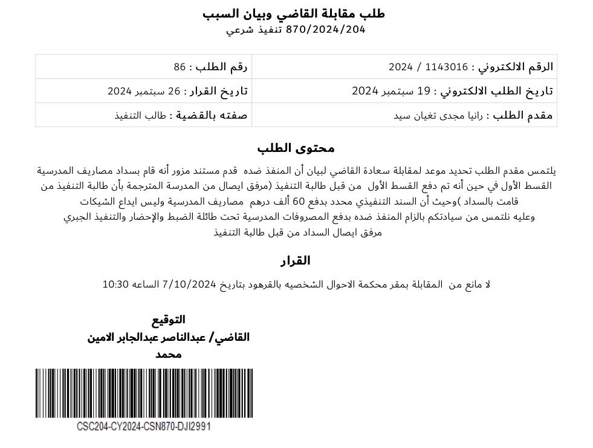

**تقرير الخبير الحسابي 19/03/2025 — المسدد 112,513.5 وصافي المستحق 51,802.15**  
المصدر: 25-04-03 أحمد طلب تقسيط إحالة 171.pdf، ص16 (تقرير الخبرة ص14) — ملف القضية 870/الطلبات الذكية

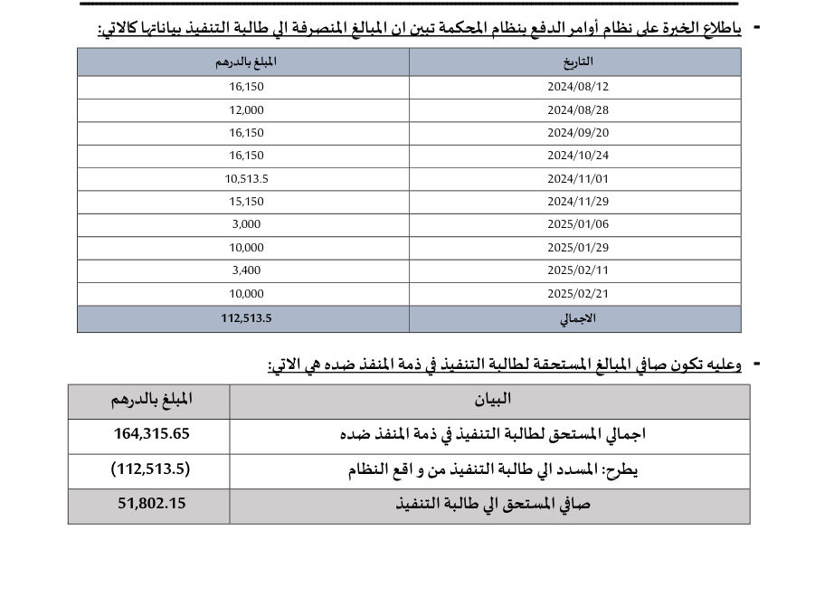

---
### 11. 07/10 – 23/10/2024 — «ينوي الهروب» ← أمر إحضار «لعدم سداد مبلغ 0»  
*إثبات متوسط*

- **ادّعت:** الطلب 92: «المنفذ ضده ينوي الهروب خارج الدولة».
- **الثابت بالمستند:** طلب أحمد 104: «طلبت منعي من السفر بناءً على ادعاءات غير صحيحة بهروبي».
- **المحكمة:** أمر الإحضار 23/10/2024: «لعدم سداد مبلغ 0» — والمبلغ المترصد 0.00. أُلغي 27/10 بعد أن سدّد.

**الطلب رقم 92 وقرار القاضي عليه — التنفيذ 870/2024/204**  
المصدر: 24-10-11 رانيا تنفيذ المنطوق توجيه 92.pdf، ص2 — ملف القضية 870/الطلبات الذكية

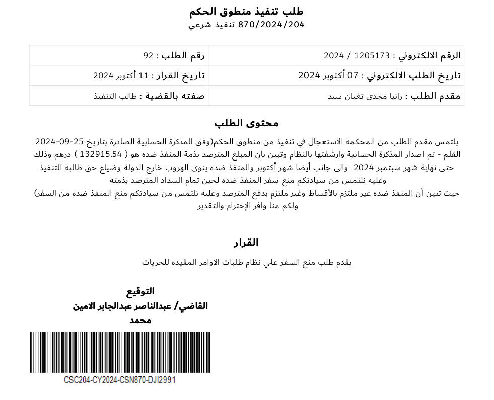

**أمر الإحضار 23/10/2024 — «لعدم سداد مبلغ 0»**  
المصدر: 24-10-23 المحكمة القرار 107735-2024-8.pdf — ملف القضية 870/أوامر الإحضار - المرفقات

**طلب أحمد 104 (17/10/2024) وقرار القاضي**  
المصدر: 24-10-22 أحمد تعقيب ورد إرجاء 104.pdf، ص8–9 — ملف القضية 870/الطلبات الذكية

---
### 12. 25/10/2024 — «عقارات تتخطى 50 مليون»  
*إثبات قوي*

- **ادّعت:** الطلب 109: «راتب المنفذ 50 ألف ولديه عقارات تتخطى 50 مليون».
- **الثابت بالمستند:** دائرة الأراضي ردّت رسمياً في 03/07/2026: «لم يتبين أن المنفذ ضده يمتلك أي عقارات».

**الطلب رقم 109 وقرار القاضي عليه — التنفيذ 870/2024/204**  
المصدر: 24-10-29 المحامية تعقيب ورد رفض 109.pdf، ص2–3 — ملف القضية 870/الطلبات الذكية

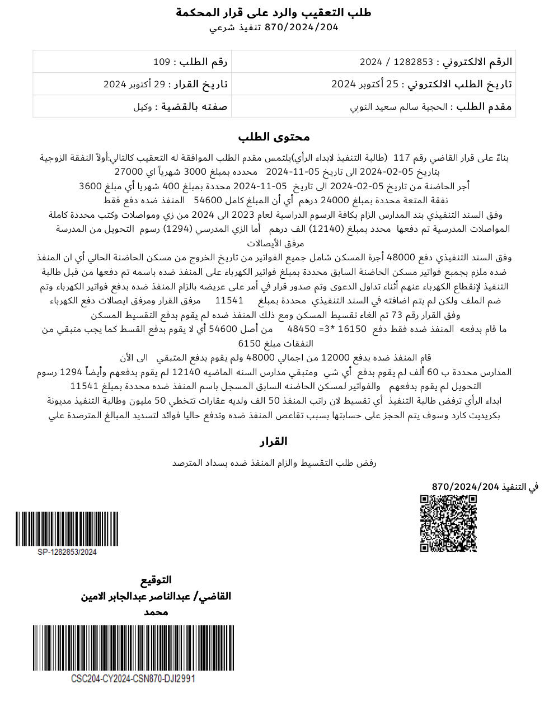

**إفادة دائرة الأراضي والأملاك: لا يمتلك أي عقارات**  
المصدر: 26-07-06 دائرة الأراضي والأملاك دبي ملف 2026 - 201865.pdf، ص2 — ملف القضية 870/الصادر و الوارد

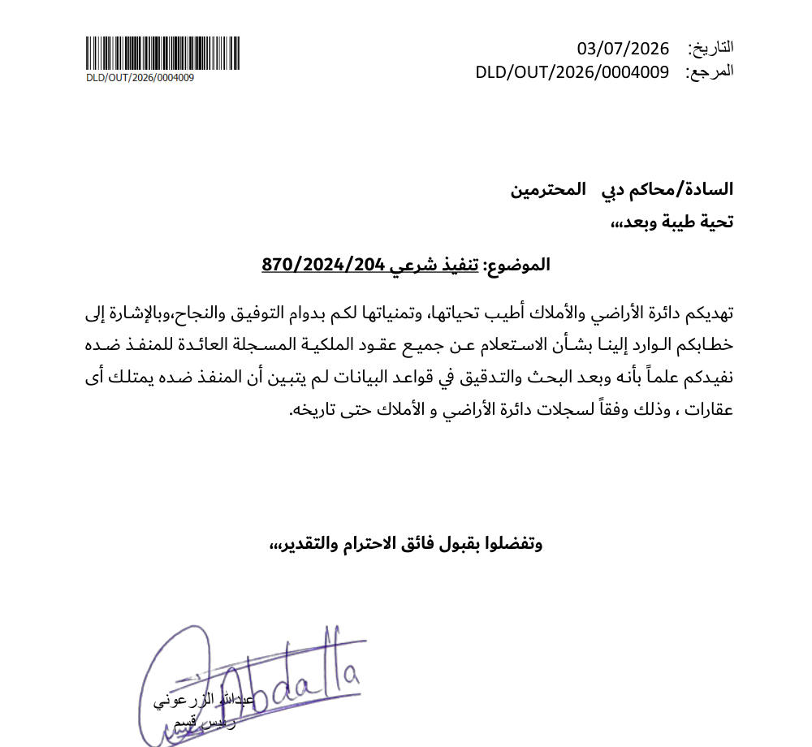

---
### 13. 04/11/2024 — «تكرار لطلب منذ أقل من عشرة أيام»  
*إثبات معتاد*

- **الثابت بالمستند:** طلب أحمد 117: «الطلبات المتكررة… ادعاءات مرسلة بلا مستندات رسمية».

**طلب أحمد 117 (04/11/2024) وقرار القاضي (09/11/2024)**  
المصدر: 24-11-07 أحمد تعقيب ورد رفض 117.pdf، ص14–15 — ملف القضية 870/الطلبات الذكية

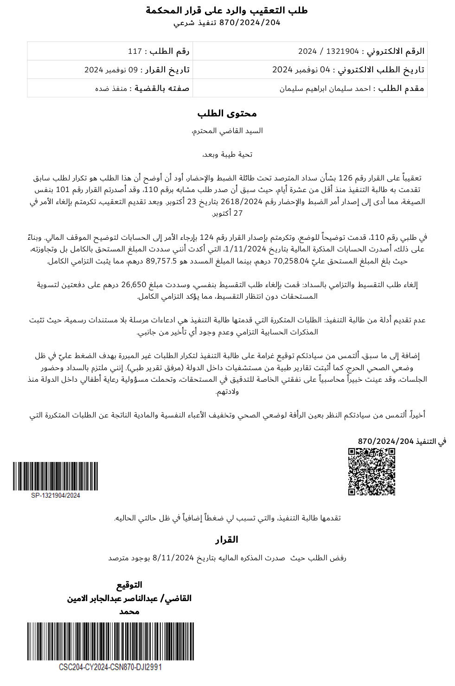

---
### 14. 26/11 – 01/12/2024 — «راتبه 50 ألف» مرة أخرى — وهو يقدّم خطاب الخفض  
*إثبات متوسط*

- **ادّعت:** الطلب 125: «المنفذ ضده راتبه 50 الف درهم… يتحايل».
- **الثابت بالمستند:** طلب أحمد 128: «أرفق مستندات تُثبت كذب طالبة التنفيذ، مثل ادعائها أن راتبي الشهري 50,000 درهم» — ومعه خطاب الخفض. ويودع أمانة الخبير 3,000 في 01/12/2024.

**الطلب رقم 125 وقرار القاضي عليه — التنفيذ 870/2024/204**  
المصدر: 24-11-28 المحامية تنفيذ المنطوق إخطار 125.pdf، ص2 — ملف القضية 870/الطلبات الذكية

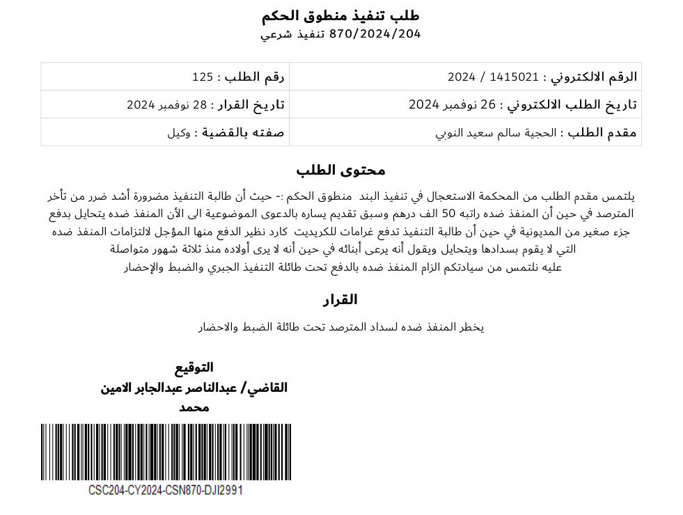

**طلب أحمد 128 (01/12/2024) وقرار 05/12/2024**  
المصدر: 24-12-05 أحمد تعقيب ورد توجيه 128.pdf، ص14–15 — ملف القضية 870/الطلبات الذكية

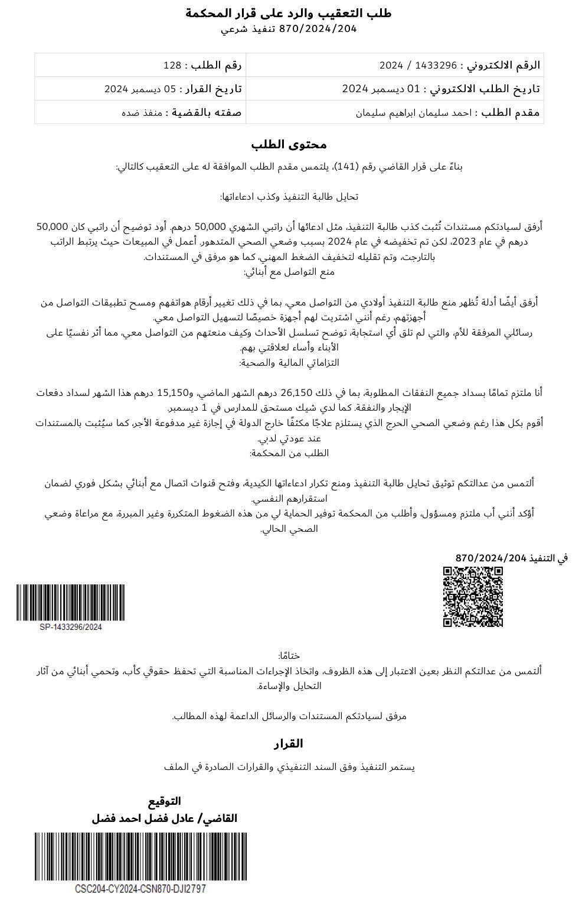

**إيصال محاكم دبي: أمانة الخبرة 3,000 درهم من أحمد**  
المصدر: 25-01-30 أحمد أتعاب الخبير إحالة 142.pdf، ص2 (ونسخته: أضرب/ايصال سداد امانه الخبره .pdf ص1)

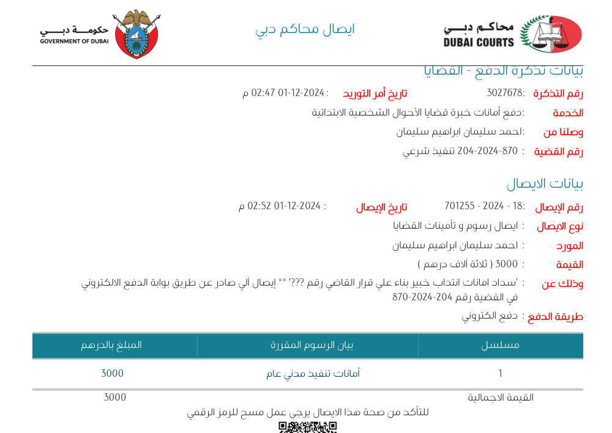

**FinMark Capital — 07/05/2024: الراتب من 50,000 إلى 25,000 اعتباراً من 1 يوليو 2024**  
المصدر: 24-08-07 أحمد شهاده راتب 66097-2024-6.pdf — ملف القضية 870/المنع من السفر - المرفقات

---
### 15. 28/12/2024 – 30/12/2024 — أمر إحضار «لعدم سداد مبلغ 0» — ووكيلتها تقرّ  
*إثبات قوي*

- **ادّعت:** وكيلتها في الطلب 134 بعد يومين: الأمر صدر «لعدم سداد مبلغ 0» وتطلب «تحديد المبلغ».
- **المحكمة:** أمر الإحضار 28/12/2024: «لعدم سداد مبلغ 0» — المترصد 0.00.

**أمر الإحضار 28/12/2024 — «لعدم سداد مبلغ 0»**  
المصدر: 24-12-28 المحكمة القرار 154584-2024-6.pdf — ملف القضية 870/أوامر الإحضار - المرفقات

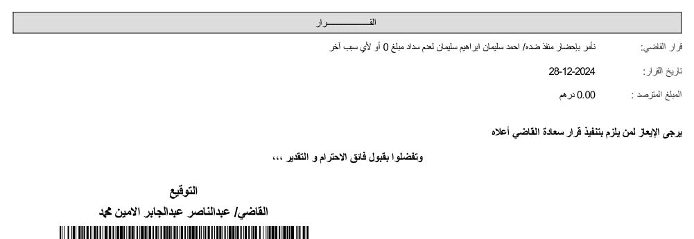

**الطلب رقم 134 وقرار القاضي عليه — التنفيذ 870/2024/204**  
المصدر: 24-12-31 المحامية تعقيب ورد إحالة 134.pdf، ص2 — ملف القضية 870/الطلبات الذكية

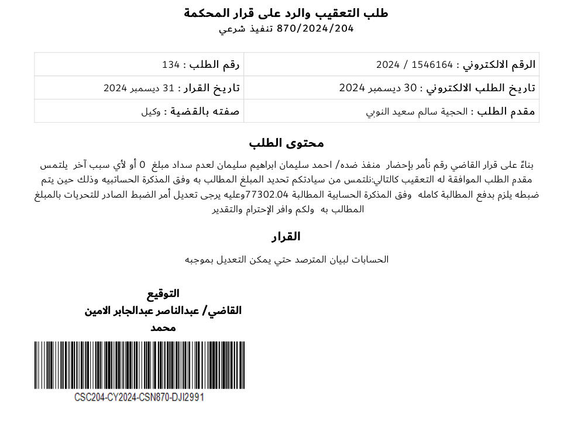

---

## 2025

### 16. 06/01/2025 — «طلبات متكررة لأوامر منع السفر وأوامر ضبط وإحضار… ادعاءات كاذبة»  
*إثبات متوسط*

- **الثابت بالمستند:** طلب أحمد 136.
- **المحكمة:** «لا مانع من المقابلة».

**طلب أحمد 136 (06/01/2025) وقرار القاضي (08/01/2025)**  
المصدر: 25-01-08 أحمد مقابلة القاضي موافقة 136.pdf، ص18–19 — ملف القضية 870/الطلبات الذكية

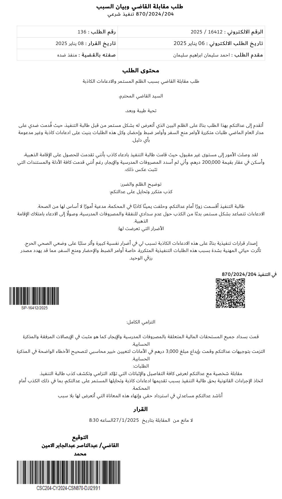

---
### 17. 06/01 – 23/02/2025 — سحبت أمانة الخبير التي دفعها — ومنع السفر يصدر وهي معها  
*إثبات قوي*

- **ادّعت:** بدل ردّها، الطلب 149 (12/02): تعقيب وطلب منع سفر. ثم صدر منع السفر 19/02/2025 — المرفق الوحيد هويته، والمبلغ في الأمر «0».
- **الثابت بالمستند:** دفع أحمد 3,000 أمانة خبير (01/12/2024). صُرفت لها في 06/01/2025. أحمد في الطلبين 148 و153: «طالبة التنفيذ قامت بسحب هذا المبلغ».
- **المحكمة:** 23/02/2025 على طلب أحمد 153: «رفع الأمر بالضبط والإحضار… إخطار طالبة التنفيذ برد مبلغ أمانة الخبرة المصروف لها خلال ثلاثة أيام تجنباً للتنفيذ العكسي».

**طلب أحمد 153 (18/02/2025) وقرار 23/02/2025**  
المصدر: 25-02-23 أحمد تعقيب ورد جزئي 153.pdf، ص2–3 — ملف القضية 870/الطلبات الذكية

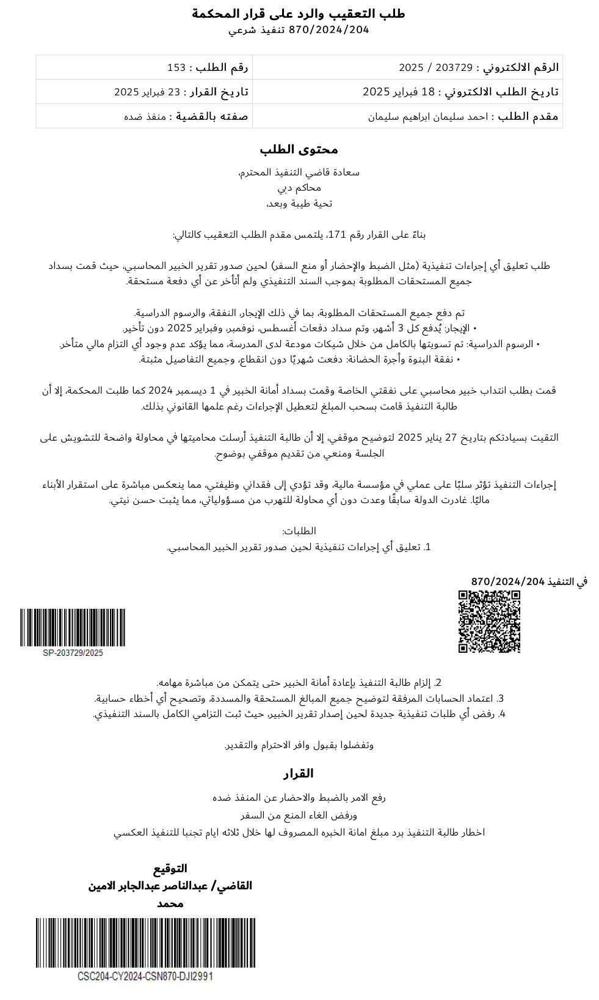

**الطلب رقم 147 وقرار القاضي عليه — التنفيذ 870/2024/204**  
المصدر: 25-02-10 المحكمة عرض القاضي إخطار 147.pdf، ص2 — ملف القضية 870/الطلبات الذكية

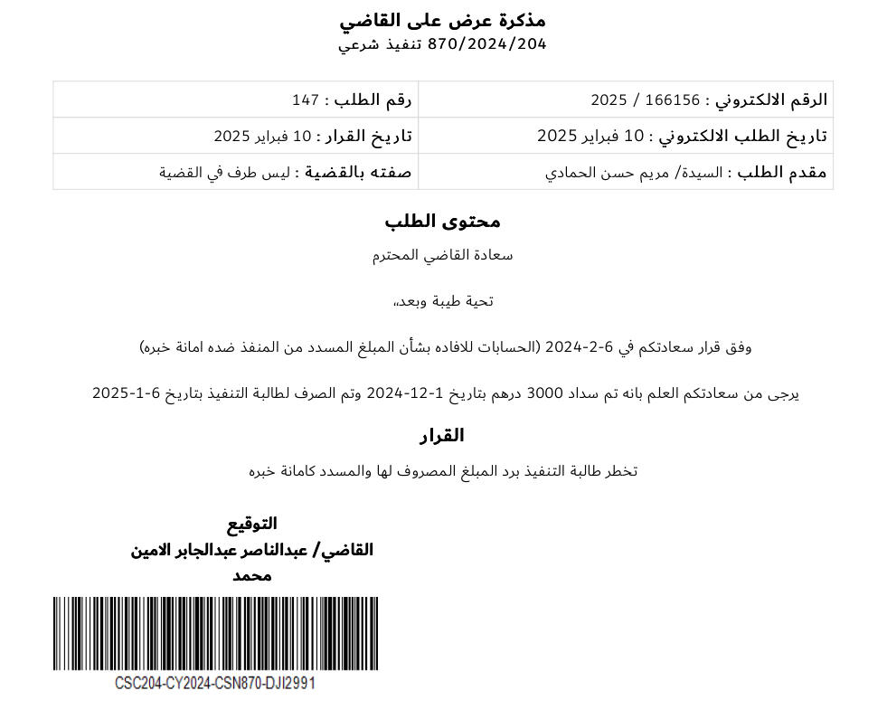

**أمر منع السفر 19/02/2025 — «بالمبلغ وقدره 0»**  
المصدر: 25-02-19 المحكمة القرار 36863-2025-4.pdf — ملف القضية 870/المنع من السفر - المرفقات

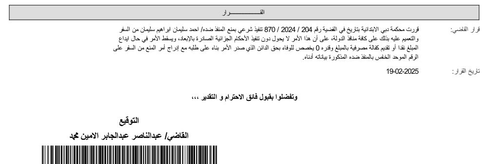

**إيصال محاكم دبي: أمانة الخبرة 3,000 درهم من أحمد**  
المصدر: 25-01-30 أحمد أتعاب الخبير إحالة 142.pdf، ص2 (ونسخته: أضرب/ايصال سداد امانه الخبره .pdf ص1)

---
### 18. 04/02/2025 — «حوّل 182,000 للخارج»  
*إثبات متوسط*

- **ادّعت:** الطلب 146: «لديه حساب بنكي خارج الدولة، وقد قام بتحويل مبلغ (182,000)».
- **الثابت بالمستند:** الكشف الذي استندت إليه: الرصيد الختامي 3.25 درهم، والتحويلات لحساب أحمد نفسه (SELF / OWN AC). والمحكمة على الطلب 164: «لإرفاق المستندات الدالة على ما ورد بالطلب».

**الطلب رقم 146 وقرار القاضي عليه — التنفيذ 870/2024/204**  
المصدر: 25-02-09 المحامية تعقيب ورد توجيه 146.pdf، ص11–12 — ملف القضية 870/الطلبات الذكية

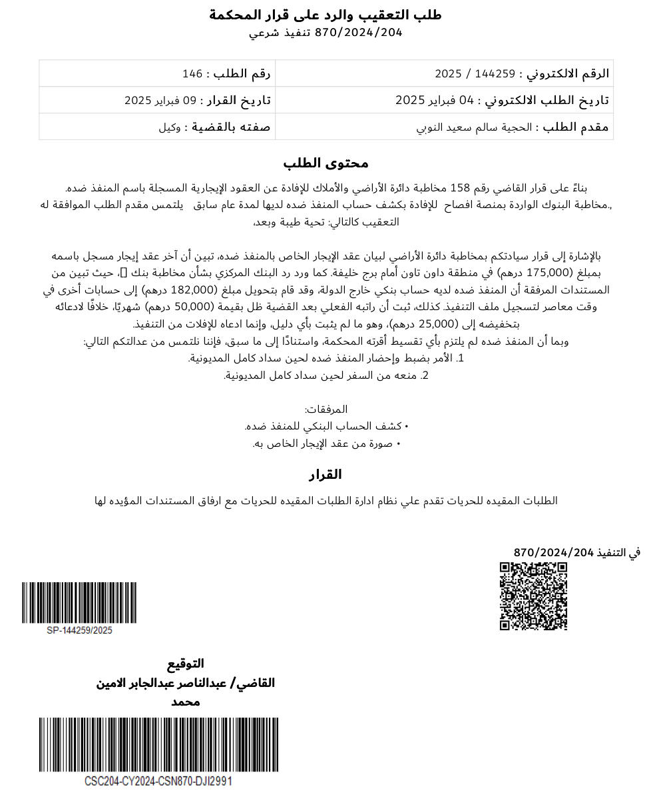

**كشف حساب CBI الذي أُرفق بطلبات الإحضار كدليل «راتب 50 ألف» و«حساب يتعدى 150 ألف»**  
المصدر: 26-06-17 رانيا كشف حساب 301395-2026-1.pdf، ص2–3 (مرفق طلب الإحضار 17/06/2026) — والصفحات نفسها في: 25-12-08 المحامية مايفيد يسار 344907-2025-2.pdf ص2–3، و25-04-15 المحامية مرفق مايثبت 83392-2025-1.pdf ص3–4 — ملف القضية 870/أوامر الإحضار - المرفقات

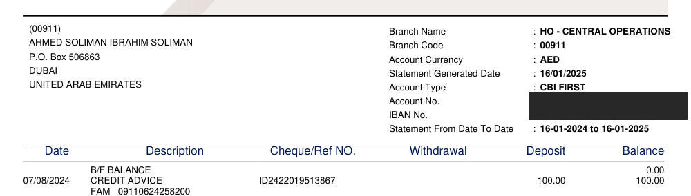

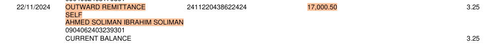

**الطلب رقم 164 وقرار القاضي عليه — التنفيذ 870/2024/204**  
المصدر: 25-03-11 المحامية تعقيب ورد استيفاء 164.pdf، ص2 — ملف القضية 870/الطلبات الذكية

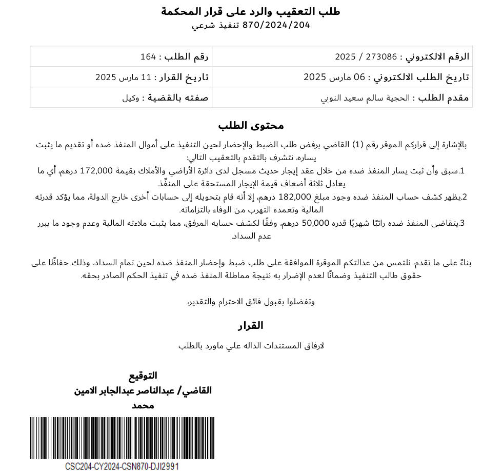

---
### 19. 09/02/2025 — أمر إحضار ثالث «لعدم سداد مبلغ 0»  
*إثبات قوي*

- **المحكمة:** «لعدم سداد مبلغ 0» — المترصد 0.00. أُلغي 11/02.

**أمر الإحضار 09/02/2025 — «لعدم سداد مبلغ 0»**  
المصدر: 25-02-09 المحكمة القرار 28626-2025-5.pdf — ملف القضية 870/أوامر الإحضار - المرفقات

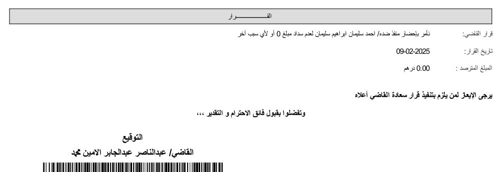

---
### 20. 19/03/2025 — تقرير الخبير  
*إثبات معتاد*

- **الثابت بالمستند:** المسدد من واقع النظام 112,513.5، وصافي المستحق 51,802.15؛ ورُفضت مطالبتها بفواتير الكهرباء 11,514.

**تقرير الخبير الحسابي 19/03/2025 — المسدد 112,513.5 وصافي المستحق 51,802.15**  
المصدر: 25-04-03 أحمد طلب تقسيط إحالة 171.pdf، ص16 (تقرير الخبرة ص14) — ملف القضية 870/الطلبات الذكية

---
### 21. 23/03 – 24/04/2025 — إقامة سليم تجددت بعلمها — قبل العريضة 2790  
*إثبات قوي*

- **الثابت بالمستند:** 23/03: «عايز صوره لسليم عشان الاقامه بتاعته منتهيه» وأرسلتها. 24/04: «إقامة سليم تم تجديدها… وإقامة آدم سارية». هوية سليم صادرة 07/04/2025 حتى 06/04/2027.

**أحمد يطلب صورة سليم لتجديد إقامته، وهي ترسلها**  
المصدر: payment/محادثة مارس ٢٠٢٥ إثبات معرفتها بتجديد اقامه سليم .png — رسالة أحمد 4:02 م (23/03/2025) وردّها بالصورة 1:28 م (24/03/2025). وجه الطفل مموّه.

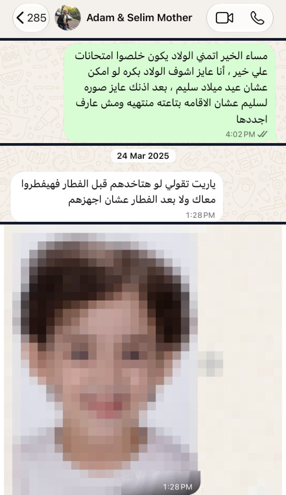

**«إقامة سليم تم تجديدها… وإقامة آدم سارية»**  
المصدر: واتساب 24/04/2025، 4:36 م — courts oct 26/What’s app photos/IMG_9253.PNG و IMG_9258.PNG

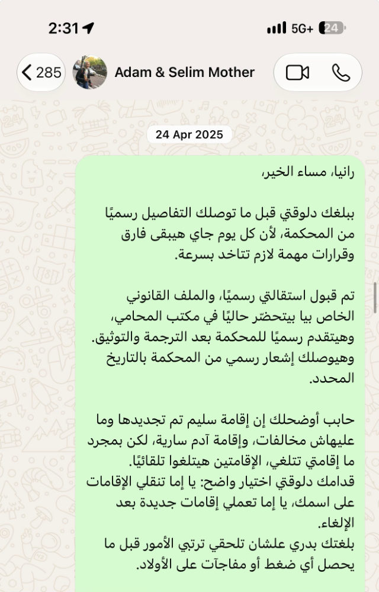

---
### 22. 17/04/2025 — أحمد يطلب معاينة مسكن الحضانة حرصاً على سلامة الأولاد  
*إثبات متوسط*

- **الثابت بالمستند:** طلب أحمد 180: معاينة مسكن الحضانة «نظراً لعدم صلاحيته وتهديده لسلامة الأطفال» — إصابات متكررة، وضيق المسكن، وأعراض على الأولاد — «علماً بأنني وفرت تأميناً طبياً شاملاً للأطفال، بما في ذلك الرعاية النفسية المتخصصة».
- **المحكمة:** «رفض الطلب لمخالفته إجراءات التنفيذ واشتماله على طلبات تخرج عن اختصاص دائرة التنفيذ».

**طلب أحمد 180 (17/04/2025) معاينة مسكن الحضانة، وقرار 23/04/2025**  
المصدر: 25-04-23 أحمد معاينة المسكن رفض 180.pdf — ملف القضية 870/الطلبات الذكية

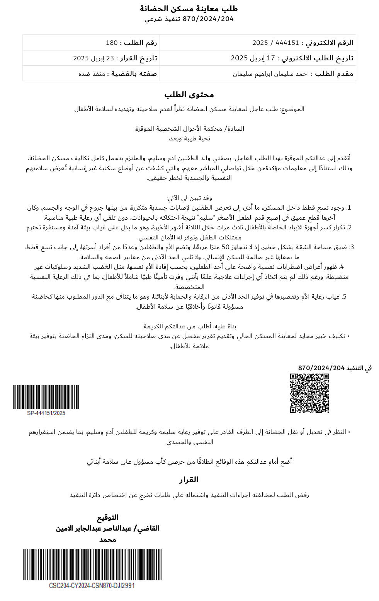

---
### 23. 08/05/2025 — يسدّد كامل المترصد  
*إثبات قوي*

- **الثابت بالمستند:** مذكرة 07/05/2025: المستحق 39,412.44. إيصال 08/05/2025: 39,413 «سداد كامل المترصد».
- **المحكمة:** «نصرح بوقف إجراءات التنفيذ»، ورُفع منع السفر.

**مذكرة المحكمة 07/05/2025 — المستحق 39,412.44**  
المصدر: 25-02-19 المحكمة المذكره الحسابيه 36863-2025-3.pdf، ص2 — ملف القضية 870/المنع من السفر - المرفقات

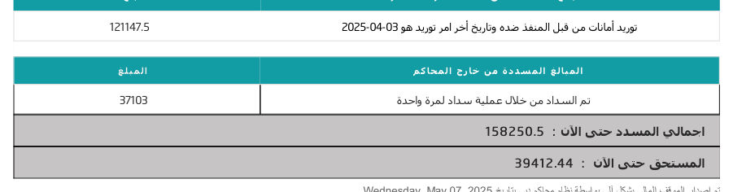

**إيصال محاكم دبي 08/05/2025 — 39,413 «سداد كامل المترصد»**  
المصدر: 25-02-19 أحمد ايصال سداد 36863-2025-2.pdf — ملف القضية 870/المنع من السفر - المرفقات

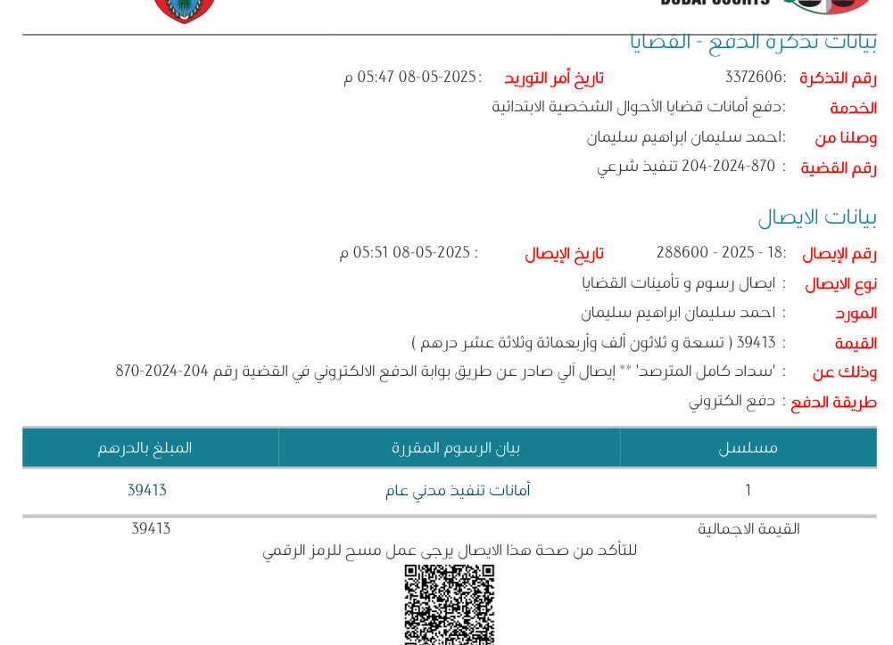

**طلب أحمد 186 (08/05/2025) وقرار 09/05/2025**  
المصدر: 25-05-08 أحمد وقف الإجراءات موافقة 186.pdf، ص9 — ملف القضية 870/الطلبات الذكية

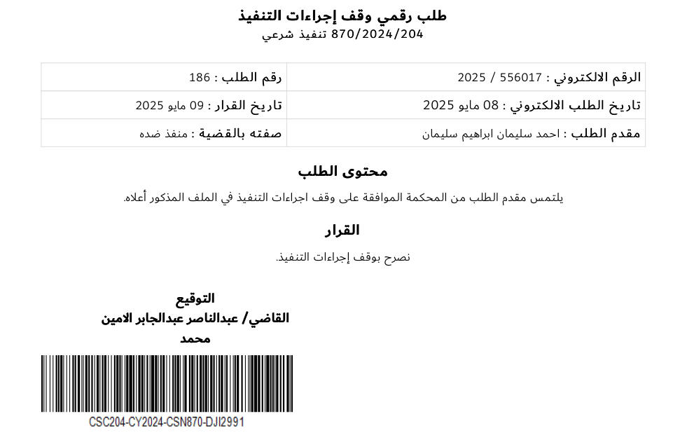

---
### 24. 09/05/2025 — اليوم التالي: حجز 80,702 على حساباته — ووافق القاضي  
*إثبات قوي*

- **ادّعت:** طلبها 187: «توقيع الحجز… في حدود مبلغ وقدره 80702.04» — بلا مرفق.
- **الثابت بالمستند:** طلب أحمد 188 و204: «لا توجد أي مذكرة حسابية صادرة من المحكمة تُثبت وجود رصيد بقيمة 80,702».
- **المحكمة:** وافق القاضي على الحجز يوم 09/05، ثم 10/05: «نصرح بإلغاء كافة إجراءات التنفيذ وكافة الحجوزات»، و13 قرار فك حجز. مذكرة 15/05: «مسدد بالزيادة».

**الطلب رقم 187 وقرار القاضي عليه — التنفيذ 870/2024/204**  
المصدر: 25-05-09 المحامية استعلام وحجز موافقة 187.pdf، ص2 — ملف القضية 870/الطلبات الذكية

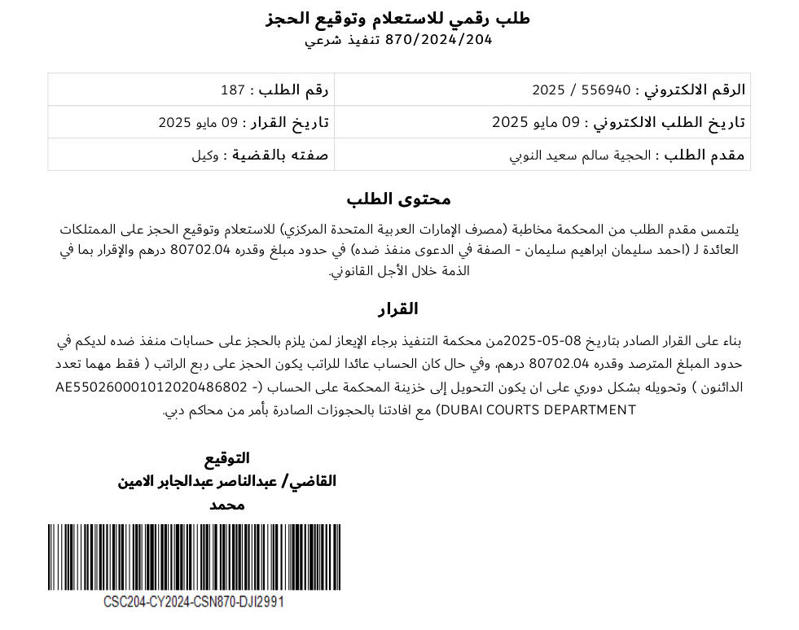

**طلب أحمد 188 (09/05/2025) وقرار القاضي**  
المصدر: 25-05-09 أحمد إلغاء الإجراءات موافقة 188.pdf، ص11 — ملف القضية 870/الطلبات الذكية

**طلب أحمد 204 (09/05/2025) وقرار القاضي**  
المصدر: 25-05-15 أحمد تعقيب ورد سبق 204.pdf، ص7–8 — ملف القضية 870/الطلبات الذكية

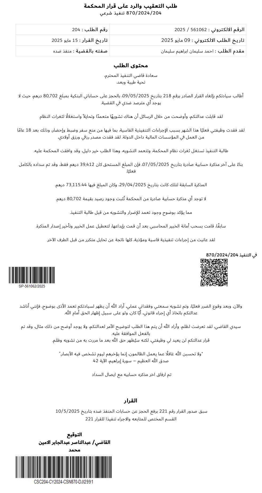

**المذكرة المالية للمحكمة 15/05/2025: «مسدد بالزيادة»**  
المصدر: 25-05-15 المحكمة مذكرة مالية 63.pdf، ص2 — ملف القضية 870/المستندات

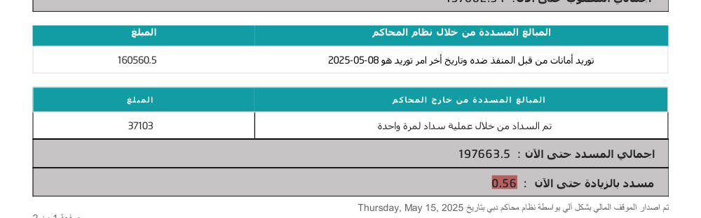

---
### 25. 19/05/2025 — «أرفق ما يفيد السداد على خلاف الحقيقة»  
*إثبات قوي*

- **ادّعت:** الطلب 208.
- **المحكمة:** «الثابت وفق البيانات المالية بالملف تم السداد بالزيادة».

**الطلب رقم 208 وقرار القاضي عليه — التنفيذ 870/2024/204**  
المصدر: 25-05-19 المحامية تعقيب ورد جزئي 208.pdf، ص2–3 — ملف القضية 870/الطلبات الذكية

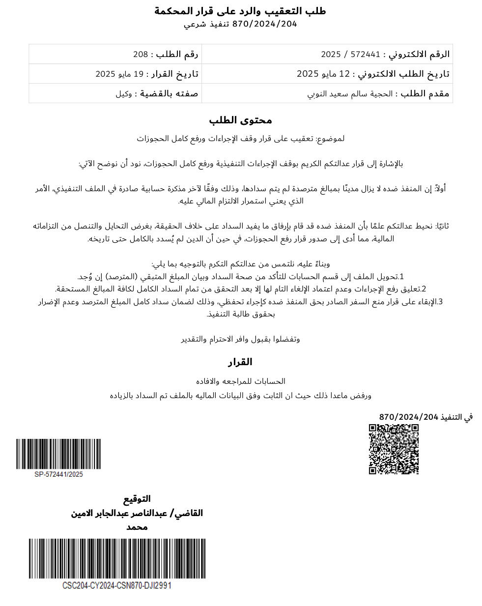

---
### 26. 02/06/2025 — أحمد يطلب الإحالة للنيابة بشأن رقم 80,702  
*إثبات معتاد*

- **الثابت بالمستند:** طلب أحمد 211.
- **المحكمة:** 16/09/2025: «رفض وعلى مقدم الطلب سلوك الطريق الذي رسمه القانون».

**الطلب رقم 211 وقرار القاضي عليه — التنفيذ 870/2024/204**  
المصدر: 25-06-02 أحمد تعقيب ورد رفض 211.pdf، ص31–32 — ملف القضية 870/الطلبات الذكية

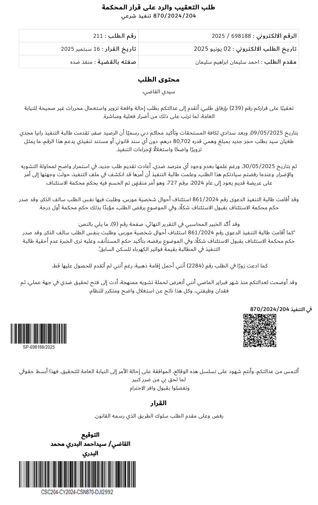

---
### 27. 07/07/2025 – 06/10/2025 — العريضة 2790: الطلب نفسه حتى «نصرح بضبط وإحضار»  
*إثبات متوسط*

- **ادّعت:** «المدعى عليه تقاعس عن تسليم هويات الأبناء» — 14 طلباً بلا مرفق.
- **المحكمة:** الطلب 9: «لا حاجة لتكرار الطلبات» — ثم الطلب 12 (06/10/2025): «نصرح بضبط وإحضار المعروض ضده».

**الطلب رقم 9 وقرار القاضي عليه — العريضة 2790/2025/56**  
المصدر: 25-09-22 المحامية تنفيذ منطوق 9.pdf، ص2 — ملف القضية 870/الدعاوى المرتبطة/عريضة 2790-2025

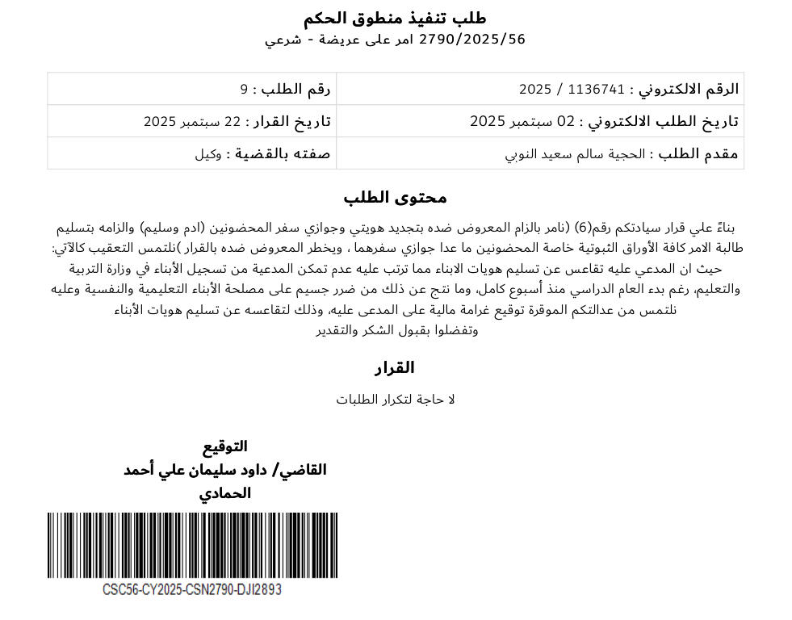

**الطلب رقم 12 وقرار القاضي عليه — العريضة 2790/2025/56**  
المصدر: 25-10-06 المحامية تنفيذ منطوق 12.pdf، ص2 — ملف القضية 870/الدعاوى المرتبطة/عريضة 2790-2025

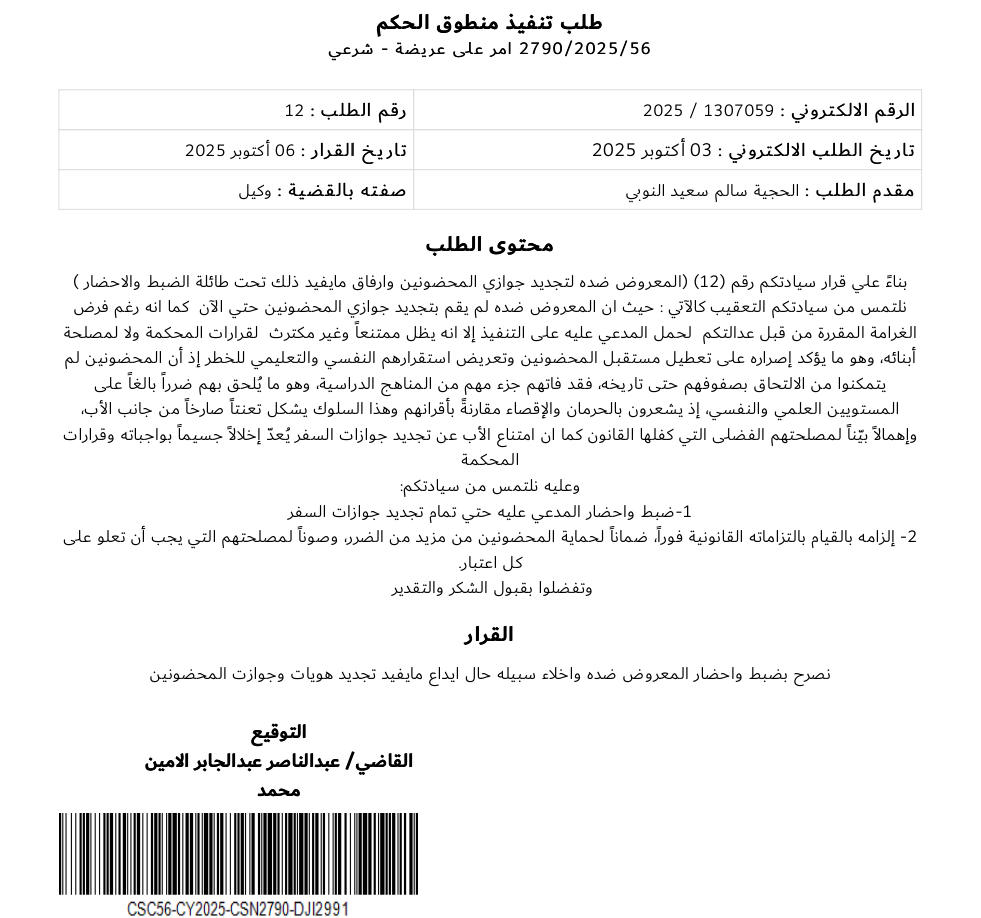

---
### 28. 09/10 – 24/10/2025 — تعلم أنه في المستشفى — وأمر إحضار «راتب 50 ألف وإقامة ذهبية»  
*إثبات قوي*

- **ادّعت:** طلب الإحضار 270977: «يقتضي راتب يفوق الـ50 ألف درهم ويمتلك إقامة ذهبية» (بيانات الطلب على البوابة).
- **الثابت بالمستند:** 09/10: «أنا لسه في المستشفى وللأسف هتحجز» — ردّها: «الف سلامه عليك». وتذكرة رحلة العلاج: مغادرة 16/10/2025 وعودة 12/11/2025 (قدّمها أحمد في طلب إلغاء الأمر وفي الطلب 244). وشهادة جهة العمل: انتهت خدمته 30/04/2025.
- **المحكمة:** صدر أمر الإحضار 24/10/2025 — المرفق الوحيد صورة هويته. أُلغي 11/11 «لتمكين المنفذ ضده من دخول الدولة».

**«أنا لسه في المستشفى وللأسف هتحجز» — «الف سلامه عليك»**  
المصدر: courts oct 26/What’s app photos/IMG_9251.PNG (09/10/2025، 3:53–7:00 م)

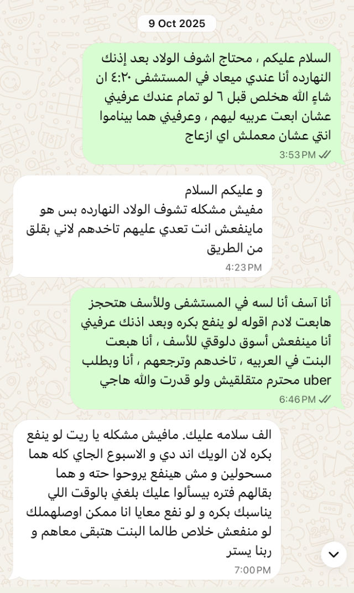

**تذكرة طيران الإمارات (حجز Q6EFB6): دبي ← القاهرة 16/10/2025، القاهرة ← دبي 12/11/2025**  
المصدر: 25-11-11 أحمد وقف الإجراءات رفض 244.pdf، ص10 — ملف القضية 870/الطلبات الذكية

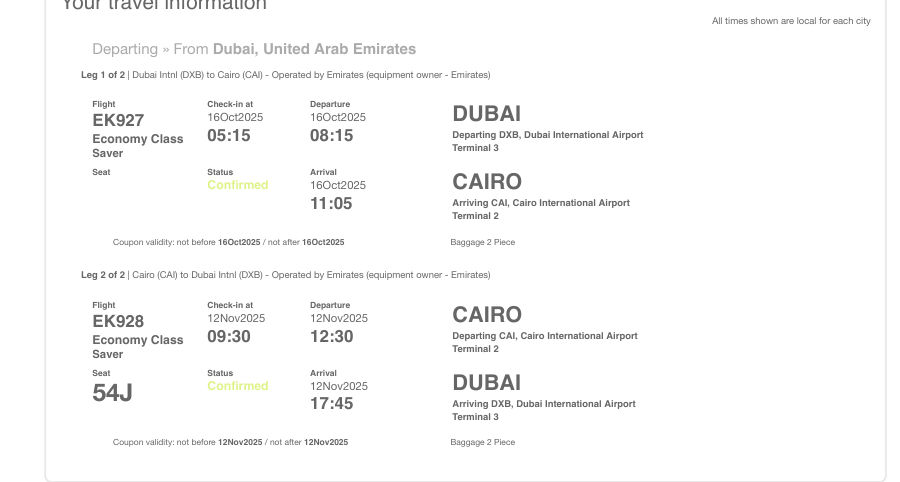

**FinMark — 25/08/2025: آخر يوم عمل 30/04/2025**  
المصدر: 25-09-22 أحمد التعقيب والرد 8.pdf، ص2 — ملف القضية 870/الدعاوى المرتبطة/عريضة 2790-2025

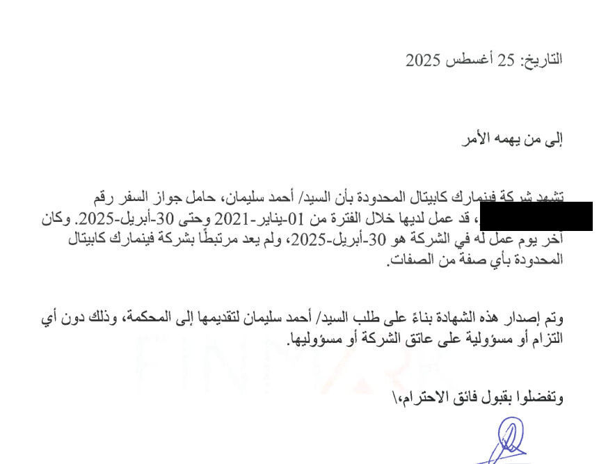

**أمر الإحضار رقم 4908/2025**  
المصدر: 25-10-24 المحكمة القرار 270977-2025-6.pdf، ص1 (جزء القرار) — ملف القضية 870/أوامر الإحضار - المرفقات

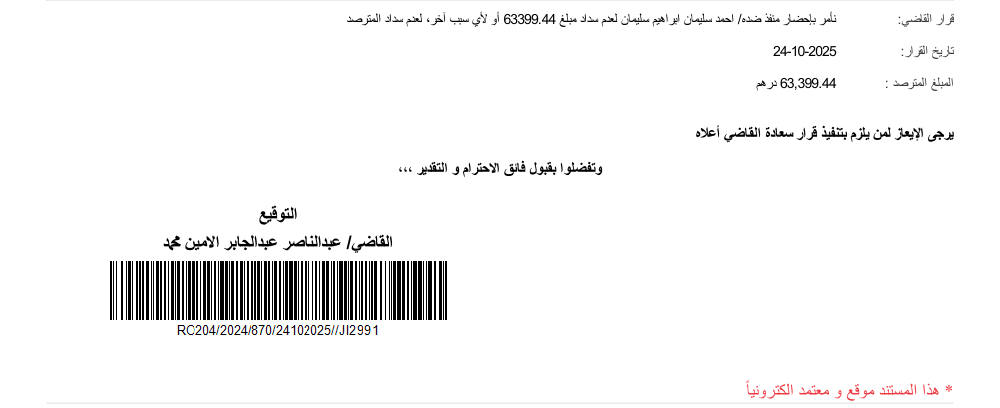

**إلغاء أمر الإحضار «لتمكين المنفذ ضده من دخول الدولة»**  
المصدر: 25-10-24 المحكمة القرار 270977-2025-7.pdf، ص1 (جزء القرار) — ملف القضية 870/أوامر الإحضار - المرفقات

---
### 29. 13/11 – 08/12/2025 — «حسابه يتعدى 150 ألف — مرفق ما يثبت» — والمرفق رصيده 3.25  
*إثبات قوي*

- **ادّعت:** الطلب 247: «ثبت أن راتبه 50 الف درهم مرفق ما يثبت وعقد إيجار منزله 175,000… وحسابه البنكي الذي يتعدى 150 الف درهم مرفق ما يثبت».
- **الثابت بالمستند:** المرفق: كشف حساب رصيده الختامي 3.25 درهم صادر 16/01/2025، وشهادة إيجار انتهت 09/08/2025. وأمام المحكمة منذ 03/04/2025 (الطلب 171) خطاب البنك: قرض شخصي رصيده 500,218.02 درهم مدين.
- **المحكمة:** أمر إحضار 08/12/2025: «لعدم سداد مبلغ 0».

**الطلب رقم 247 وقرار القاضي عليه — التنفيذ 870/2024/204**  
المصدر: 25-12-01 المحامية تنفيذ المنطوق توجيه 247.pdf، ص15 — ملف القضية 870/الطلبات الذكية

**كشف حساب CBI الذي أُرفق بطلبات الإحضار كدليل «راتب 50 ألف» و«حساب يتعدى 150 ألف»**  
المصدر: 26-06-17 رانيا كشف حساب 301395-2026-1.pdf، ص2–3 (مرفق طلب الإحضار 17/06/2026) — والصفحات نفسها في: 25-12-08 المحامية مايفيد يسار 344907-2025-2.pdf ص2–3، و25-04-15 المحامية مرفق مايثبت 83392-2025-1.pdf ص3–4 — ملف القضية 870/أوامر الإحضار - المرفقات

**شهادة إيجاري التي أُرفقت كدليل «يسار»**  
المصدر: 26-06-17 رانيا كشف حساب 301395-2026-1.pdf، ص4 (ونفسها في 25-12-08 المحامية مايفيد يسار 344907-2025-2.pdf ص4) — ملف القضية 870/أوامر الإحضار - المرفقات

**بنك الإمارات دبي الوطني — خطاب مديونية 08/12/2023: قرض شخصي 500,218.02 درهم مدين**  
المصدر: 25-04-03 أحمد طلب تقسيط إحالة 171.pdf، ص2 — ملف القضية 870/الطلبات الذكية

**أمر الإحضار رقم 5619/2025**  
المصدر: 25-12-08 المحكمة القرار 344907-2025-8.pdf، ص1 (جزء القرار) — ملف القضية 870/أوامر الإحضار - المرفقات

---
### 30. 08/12/2025 — «تم الحجز على 13,270» — ورد البنك المرفق: المجمَّد 0  
*إثبات متوسط*

- **ادّعت:** الطلب 251.
- **المحكمة:** «نصرح وفق مضمون الطلب».

**الطلب رقم 251 وقرار القاضي عليه — التنفيذ 870/2024/204**  
المصدر: 25-12-08 المحكمة تنفيذ المنطوق موافقة 251.pdf، ص3 — ملف القضية 870/الطلبات الذكية

**رد مصرف أبوظبي الإسلامي المرفق بالطلب 251**  
المصدر: 25-12-08 المحكمة تنفيذ المنطوق موافقة 251.pdf، ص2 — ملف القضية 870/الطلبات الذكية

---

## 2026

### 31. 04/01 – 19/01/2026 — دفع المدرسة بنفسه — وغرامة لأن الأولاد «لم يلتحقوا بصفوفهم»  
*إثبات قوي*

- **ادّعت:** العريضة 2790، الطلب 21 (05/01): «المحضونين لم يتمكنوا من الالتحاق بصفوفهم» + منع سفره «خوفاً من هروبه».
- **الثابت بالمستند:** 04/01: سدّد 10,753 + 7,647 لمدرسة GEMS وأرسل لها الإيصالين. ووكيلتها نفسها في الطلب 256: «المنفذ ضده قام بسداد مبلغ 18400 درهم».
- **المحكمة:** «يغرم المعروض ضده 3000 درهم إضافية».

**أحمد يرسل لها إيصالي المدرسة (10,753 و7,647)**  
المصدر: courts oct 26/What’s app photos/IMG_9262.PNG (04/01/2026، 3:45–3:47 م)

**الطلب رقم 256 وقرار القاضي عليه — التنفيذ 870/2024/204**  
المصدر: 26-01-21 المحامية تعقيب ورد إحالة 256.pdf، ص2 — ملف القضية 870/الطلبات الذكية

**الطلب رقم 21 وقرار القاضي عليه — العريضة 2790/2025/56**  
المصدر: 26-01-19 المحامية التعقيب والرد 21.pdf، ص2 — ملف القضية 870/الدعاوى المرتبطة/عريضة 2790-2025

---
### 32. 17/01/2026 — جدّد إقامته حتى 2028  
*إثبات متوسط*

- **الثابت بالمستند:** هوية مقيم صادرة 17/01/2026 سارية حتى 16/01/2028 — مرفقة بطلبه 260.

**هوية مقيم أحمد — صادرة 17/01/2026، تنتهي 16/01/2028**  
المصدر: payment/26-01-29 أحمد إلغاء الإجراءات موافقة 260.pdf، ص2

---
### 33. 20/01 – 23/01/2026 — سدّد 66,420 — وبعد يومين منع السفر «لأنها أفادت بالخشية من هروبه»  
*إثبات قوي*

- **ادّعت:** 22/01: طلب منع السفر في العريضة 2790 — المرفق الوحيد صورة هويته. وفي اليوم نفسه الطلب 281 عن التأمين «تحت طائلة الضبط والإحضار».
- **الثابت بالمستند:** 20/01: إيصالا المحكمة 45,000 + 21,420، وأُلغي أمر الإحضار. 23/01: مذكرة المحكمة «مسدد بالزيادة 9.74».
- **المحكمة:** أمر منع السفر 22/01/2026: «وأفادت طالبة التنفيذ بوجود الخشية من هروبه» — والكفالة «بالمبلغ وقدره 0».

**إيصالا محاكم دبي 20/01/2026: 45,000 + 21,420 درهم**  
المصدر: 26-01-20 أحمد وقف الإجراءات إرجاء 255.pdf، ص10 وص13 — ملف القضية 870/الطلبات الذكية

**إلغاء أمر الإحضار بتاريخ 20/01/2026 لحين إجراء المحاسبة**  
المصدر: 25-12-08 المحكمة القرار 344907-2025-9.pdf، ص1 (جزء القرار) — ملف القضية 870/أوامر الإحضار - المرفقات

**الطلب رقم 281 وقرار القاضي عليه — التنفيذ 870/2024/204**  
المصدر: 26-02-10 المحامية تنفيذ المنطوق إخطار 281.pdf، ص2 — ملف القضية 870/الطلبات الذكية

**أمر المنع من السفر في العريضة 2790/2025/56**  
المصدر: أمر منع من السفر-2790202556-23.pdf، ص1 (جزء القرار) — فولدر payments.

**المذكرة المالية للمحكمة 23/01/2026: «مسدد بالزيادة 9.74»**  
المصدر: 26-01-23 المحكمة المذكرات المالية 76.pdf، ص3 — ملف القضية 870/المستندات

---
### 34. 22/01 – 30/10/2026 — التأمين: ستة طلبات — والبطاقات أُرسلت لها مرتين  
*إثبات قوي*

- **ادّعت:** الطلبات 281 (22/01)، 403 (11/06)، 415 (24/08)، 416 (04/09)، 417 (15/09)، 420 (30/10): «عدم توفير تأمين صحي بتاتاً». واستخدمته في طلب منع السفر في 2790.
- **الثابت بالمستند:** تأمين آدم وسليم لم يتوقف منذ ولادتهما ويتجدد كل سنة، وأبلغها هاتفياً بتجديده 04/01/2026. فاتورتاها 08/01/2026: دفع التأمين 459.16 ودفعت 50. البطاقتان سارية 10/01/2026 – 09/01/2027، أرسلهما لها 29/01/2026 و20/08/2026.
- **المحكمة:** 10/09/2026: «الطلب خارج السند التنفيذي». 06/10/2026: على طالبة التنفيذ «إرفاق ما يفيد من شركة التأمين بعدم تغطية التأمين».

**بطاقتا التأمين الصحي (Orient / NAS) — سارية 10/01/2026 إلى 09/01/2027**  
المصدر: courts oct 26/What’s app photos/IMG_9222.PNG (29/01/2026، 5:21–5:22 م)

**إعادة إرسال بطاقتي التأمين في 20/08/2026**  
المصدر: courts oct 26/What’s app photos/IMG_9236.PNG (20/08/2026، 4:55 م)

**فاتورة Mediclinic التي قدمتها طالبة التنفيذ نفسها «لعدم توفير التأمين»**  
المصدر: 26-06-21 المحكمة تنفيذ المنطوق مخاطبة 403.pdf، ص2 (الفواتير ص2–5) — ملف القضية 870/الطلبات الذكية

**الطلب رقم 281 وقرار القاضي عليه — التنفيذ 870/2024/204**  
المصدر: 26-02-10 المحامية تنفيذ المنطوق إخطار 281.pdf، ص2 — ملف القضية 870/الطلبات الذكية

**الطلب رقم 415 وقرار القاضي عليه — التنفيذ 870/2024/204**  
المصدر: 26-09-09 المحامية تنفيذ المنطوق خارج 415.pdf، ص6 — ملف القضية 870/الطلبات الذكية

**الطلب رقم 417 وقرار القاضي عليه — التنفيذ 870/2024/204**  
المصدر: 26-09-30 المحكمة تعقيب ورد إخطار 417.pdf، ص6 — ملف القضية 870/الطلبات الذكية

**الطلب 420 (30/10/2026) كما يظهر في قائمة الطلبات ببوابة محاكم دبي**  
المصدر: Request 2/Screenshot 2026-10-30 at 4.56.14 PM.png (صف الطلب 420)

---
### 35. 03/02 – 10/02/2026 — بعد «مسدد بالزيادة» بـ11 يوماً: ضبط وإحضار من أجل 3,390  
*إثبات متوسط*

- **ادّعت:** الطلب 283.
- **الثابت بالمستند:** طلب أحمد 282: «ثبت سداد كافة المبالغ».
- **المحكمة:** على طلب أحمد: «رفض بناءً على المترصد بالمذكرة الحسابية بتاريخ 2/2/2026».

**الطلب رقم 283 وقرار القاضي عليه — التنفيذ 870/2024/204**  
المصدر: 26-02-10 المحامية تعقيب ورد إخطار 283.pdf، ص2 — ملف القضية 870/الطلبات الذكية

**طلب أحمد 282 (29/01/2026) وقرار 10/02/2026**  
المصدر: 26-02-10 أحمد تنفيذ المنطوق رفض 282.pdf، ص2 — ملف القضية 870/الطلبات الذكية

---
### 36. 15/03 – 03/06/2026 — «لم يسدد ولا درهم بمناسبة العيد» — بعد 15,000 للعيد  
*إثبات قوي*

- **ادّعت:** الطلب 401 (03/06): «لم يسدد ولا درهم… بمناسبة العيد ولم يكترث لهم بتاتاً».
- **الثابت بالمستند:** 15/03: «أنا حولت ١٠,٠٠٠ فلوس العيد» — ردّها: «هخليهم لهدوم العيد». 24/05: 5,000 «دي فلوس العيد للولاد».

**«أنا حولت ١٠,٠٠٠ فلوس العيد، ٥ آلاف لآدم و٥ لسليم» — وردّها**  
المصدر: courts oct 26/What’s app photos/IMG_9218.PNG (15/03/2026، 4:29 ص) وIMG_9227.PNG (2:12 م)

**تحويل 5,000 درهم في 24/05/2026 — Memo: Eid Clothes for Adam and Selim**  
المصدر: courts oct 26/What’s app photos/IMG_9235.PNG (24/05/2026، 6:07–6:08 م) + courts oct 26/Transaction receipt 2.pdf ص1

**الطلب رقم 401 وقرار القاضي عليه — التنفيذ 870/2024/204**  
المصدر: 26-06-10 المحكمة تنفيذ المنطوق توجيه 401.pdf، ص2 — ملف القضية 870/الطلبات الذكية

---
### 37. 02/04 – 13/05/2026 — الطلب نفسه: رُفض ثم قُبل بلا مرفق  
*إثبات قوي*

- **ادّعت:** الطلبان 293 و397: تحويل «المبلغ المحجوز» من البنك.
- **المحكمة:** 02/04: «رفض لحين إرفاق ما يفيد بوجود مبلغ تم الحجز عليه». 13/05: النص نفسه بلا مرفق — «نصرح بالتحويل».

**الطلب رقم 293 وقرار القاضي عليه — التنفيذ 870/2024/204**  
المصدر: 26-04-02 المحامية تحويل محجوز رفض 293.pdf، ص2 — ملف القضية 870/الطلبات الذكية

**الطلب رقم 397 وقرار القاضي عليه — التنفيذ 870/2024/204**  
المصدر: 26-05-13 المحامية تحويل محجوز موافقة 397.pdf، ص2 — ملف القضية 870/الطلبات الذكية

---
### 38. 17/06/2026 — أمر الإحضار الساري: «راتبه يتعدى 50 ألف — مرفق ما يفيد»  
*إثبات قوي*

- **ادّعت:** طلب الإحضار 301395 (بيانات الطلب على البوابة).
- **الثابت بالمستند:** المرفق: نفس كشف 2025 برصيد 3.25 وشهادة إيجار منتهية — لا مستند واحد من 2026. وخدمته منتهية منذ 30/04/2025.
- **المحكمة:** صدر أمر الإحضار في اليوم نفسه.

**أمر الإحضار رقم 3859/2026 (القرار 438) — الساري**  
المصدر: 26-06-17 المحكمة القرار 301395-2026-2.pdf، ص1 (جزء القرار) — ملف القضية 870/أوامر الإحضار - المرفقات

**كشف حساب CBI الذي أُرفق بطلبات الإحضار كدليل «راتب 50 ألف» و«حساب يتعدى 150 ألف»**  
المصدر: 26-06-17 رانيا كشف حساب 301395-2026-1.pdf، ص2–3 (مرفق طلب الإحضار 17/06/2026) — والصفحات نفسها في: 25-12-08 المحامية مايفيد يسار 344907-2025-2.pdf ص2–3، و25-04-15 المحامية مرفق مايثبت 83392-2025-1.pdf ص3–4 — ملف القضية 870/أوامر الإحضار - المرفقات

**شهادة إيجاري التي أُرفقت كدليل «يسار»**  
المصدر: 26-06-17 رانيا كشف حساب 301395-2026-1.pdf، ص4 (ونفسها في 25-12-08 المحامية مايفيد يسار 344907-2025-2.pdf ص4) — ملف القضية 870/أوامر الإحضار - المرفقات

**FinMark — 25/08/2025: آخر يوم عمل 30/04/2025**  
المصدر: 25-09-22 أحمد التعقيب والرد 8.pdf، ص2 — ملف القضية 870/الدعاوى المرتبطة/عريضة 2790-2025

---
### 39. 03/07 – 08/07/2026 — الأراضي: «لا عقارات» — وبعد 5 أيام تطلب إعادة المخاطبة  
*إثبات قوي*

- **ادّعت:** الطلب 406 (08/07).
- **المحكمة:** إفادة دائرة الأراضي 03/07/2026.

**إفادة دائرة الأراضي والأملاك: لا يمتلك أي عقارات**  
المصدر: 26-07-06 دائرة الأراضي والأملاك دبي ملف 2026 - 201865.pdf، ص2 — ملف القضية 870/الصادر و الوارد

**الطلب رقم 406 وقرار القاضي عليه — التنفيذ 870/2024/204**  
المصدر: 26-07-21 المحامية تعقيب ورد مخاطبة 406.pdf، ص2 — ملف القضية 870/الطلبات الذكية

---
### 40. 30/08 – 04/09/2026 — «أنا عندي جلطة… عاوز ادفع» — حوّل 20,000 «وصلوا» — ثم «لم يسدد»  
*إثبات قوي*

- **ادّعت:** 04/09، الطلب 416: «لم يسدد المنفذ ضده حتى الآن».
- **الثابت بالمستند:** 30/08: «رانيا أنا عندي جلطه… أنا عاوز ادفع الفلوس». 02/09: تحويل 20,000 — ردّها 10:18 م: «تسلم يا احمد وصلوا».

**«رانيا أنا عندي جلطه… أنا عاوز ادفع الفلوس» ثم إرسالها مذكرة المحكمة**  
المصدر: courts oct 26/What’s app photos/IMG_9238.PNG (30/08/2026، 12:49 ص – 12:40 م)

**تحويل 20,000 درهم في 02/09/2026 وإقرارها «وصلوا»**  
المصدر: courts oct 26/What’s app photos/IMG_9248.PNG (02/09/2026، 9:38 م و10:18 م) + courts oct 26/Transaction receipt.pdf ص1

**الطلب رقم 416 وقرار القاضي عليه — التنفيذ 870/2024/204**  
المصدر: 26-09-10 المحكمة تعقيب ورد جزئي 416.pdf، ص8 — ملف القضية 870/الطلبات الذكية

---

## ما قاله أحمد للمحكمة (طلباته بالتاريخ)

### 07/08/2024 — طلب أحمد 30

> طالبة التنفيذ تضغط علي بكثرة الطلبات وادعاءات منع السفر والحجز على الحسابات البنكية… وتدعي أنني أملك أموالاً طائلة، في حين أن دخلي الشهري هو 25 ألف درهم كما هو مثبت لسيادتكم.

- **المرفق:** إيميل مدرسة GEMS: «Tuition fee has been fully paid»
- **قرار المحكمة:** «الطلب مكرر»

**طلب أحمد 30 (07/08/2024) وقرار القاضي**  
المصدر: 24-08-09 أحمد مقابلة القاضي مكرر 30.pdf، ص12–13 — ملف القضية 870/الطلبات الذكية

---
### 21/08/2024 — طلب أحمد 52

> يلتمس مقدم الطلب من عدالتكم الموقرة الموافقة على إلغاء إجراءات التنفيذ في الموقف المذكور أعلاه.

- **المرفق:** إيصال محاكم دبي 21/08/2024: 12,000 «سداد أول دفعة من قسط الإيجار»
- **قرار المحكمة:** «تصرح بوقف إجراءات التنفيذ والغاء الحجوزات عن الحسابات البنكية»

**طلب أحمد 52 وقرار 22/08/2024: وقف الإجراءات وإلغاء الحجوزات البنكية**  
المصدر: 24-08-21 أحمد وقف الإجراءات موافقة 52.pdf، ص6 — ملف القضية 870/الطلبات الذكية

---
### 21/08/2024 — طلب أحمد 58

> لقد قمت بتسديد كامل الرسوم المدرسية للسنة الماضية… ومع ذلك، فإن طالبة التنفيذ لم تقدم أي مستندات أو معلومات.

- **المرفق:** كشفا حساب المدرسة برصيد صفر
- **قرار المحكمة:** «القسم المختص لإعادة إسناد الملف للقاضي المختص»

**طلب أحمد 58 (21/08/2024) وقرار القاضي**  
المصدر: 24-08-28 أحمد تعقيب ورد إحالة 58.pdf، ص5–6 — ملف القضية 870/الطلبات الذكية

---
### 22/08/2024 — طلب أحمد 64

> قرار التعميم بمنعي من السفر تم استناداً إلى مبلغ 150 ألف درهم، وهو مبلغ غير موجود في أي من المذكرات الحسابية.

- **المرفق:** خطاب المدرسة بسداد 2023/2024 (مترجم)
- **قرار المحكمة:** «لسداد الرسوم الدراسية للعام الحالي 2024-2025»

**طلب أحمد 64 (22/08/2024) وقرار القاضي**  
المصدر: 24-08-29 أحمد مقابلة القاضي إخطار 64.pdf، ص5–6 — ملف القضية 870/الطلبات الذكية

---
### 17/10/2024 — طلب أحمد 104

> طالبة التنفيذ قد طلبت من سيادتكم منعي من السفر، وذلك بناءً على ادعاءات غير صحيحة بهروبي من البلاد.

- **المرفق:** إيصال 16,150
- **قرار المحكمة:** «إرجاء — والحسابات لتدقيق الطلب»

**طلب أحمد 104 (17/10/2024) وقرار القاضي**  
المصدر: 24-10-22 أحمد تعقيب ورد إرجاء 104.pdf، ص8–9 — ملف القضية 870/الطلبات الذكية

---
### 25/10/2024 — طلب أحمد 110

> استندت طالبة التنفيذ… إلى مذكرة حسابية خاطئة صادرة في 25 يوليو… بهدف تضليل المحكمة.

- **المرفق:** حكم 397 والمذكرة الحسابية
- **قرار المحكمة:** «الحسابات لبيان الموقف المالي بالملف والعرض»

**طلب أحمد 110 (25/10/2024) وقرار القاضي (29/10/2024)**  
المصدر: 24-10-29 أحمد تعقيب ورد إحالة 110.pdf، ص10–11 — ملف القضية 870/الطلبات الذكية

---
### 04/11/2024 — طلب أحمد 117

> هذا الطلب هو تكرار لطلب سابق تقدمت به طالبة التنفيذ منذ أقل من عشرة أيام… ادعاءات مرسلة بلا مستندات رسمية.

- **المرفق:** إيصالات 16,150 و10,513.5 ومذكرة 01/11/2024
- **قرار المحكمة:** «رفض الطلب حيث صدرت المذكرة المالية بتاريخ 8/11/2024 بوجود مترصد»

**طلب أحمد 117 (04/11/2024) وقرار القاضي (09/11/2024)**  
المصدر: 24-11-07 أحمد تعقيب ورد رفض 117.pdf، ص14–15 — ملف القضية 870/الطلبات الذكية

---
### 01/12/2024 — طلب أحمد 128

> أرفق لسيادتكم مستندات تُثبت كذب طالبة التنفيذ، مثل ادعائها أن راتبي الشهري 50,000 درهم.

- **المرفق:** خطاب خفض الراتب إلى 25,000
- **قرار المحكمة:** «يستمر التنفيذ وفق السند التنفيذي والقرارات الصادرة في الملف»

**طلب أحمد 128 (01/12/2024) وقرار 05/12/2024**  
المصدر: 24-12-05 أحمد تعقيب ورد توجيه 128.pdf، ص14–15 — ملف القضية 870/الطلبات الذكية

**FinMark Capital — 07/05/2024: الراتب من 50,000 إلى 25,000 اعتباراً من 1 يوليو 2024**  
المصدر: 24-08-07 أحمد شهاده راتب 66097-2024-6.pdf — ملف القضية 870/المنع من السفر - المرفقات

---
### 06/01/2025 — طلب أحمد 136

> قُدمت ضدي… طلبات متكررة لأوامر منع السفر وأوامر ضبط وإحضار، وكل هذه الطلبات بنيت على ادعاءات كاذبة وغير مدعومة بأي دليل.

- **المرفق:** سند المدرسة 19,044 ومذكرة 06/01/2025
- **قرار المحكمة:** «لا مانع من المقابلة»

**طلب أحمد 136 (06/01/2025) وقرار القاضي (08/01/2025)**  
المصدر: 25-01-08 أحمد مقابلة القاضي موافقة 136.pdf، ص18–19 — ملف القضية 870/الطلبات الذكية

---
### 11/02/2025 — طلب أحمد 148

> قمت بإيداع 3,000 درهم كأمانة الخبير المحاسبي… إلا أن طالبة التنفيذ قامت بسحب هذا المبلغ.

- **المرفق:** —
- **قرار المحكمة:** «يصرح بإجراء المحاسبة»

**طلب أحمد 148 (11/02/2025)**  
المصدر: 25-02-11 أحمد طلب محاسبة موافقة 148.pdf، ص2–3 — ملف القضية 870/الطلبات الذكية

---
### 18/02/2025 — طلب أحمد 153

> قمت بطلب انتداب خبير محاسبي على نفقتي الخاصة وقمت بسداد أمانة الخبير في 1 ديسمبر 2024 كما طلبت المحكمة، إلا أن طالبة التنفيذ قامت بسحب المبلغ رغم علمها القانوني بذلك.

- **المرفق:** —
- **قرار المحكمة:** «رفع الأمر بالضبط والإحضار… إخطار طالبة التنفيذ برد مبلغ أمانة الخبرة… خلال ثلاثة أيام تجنباً للتنفيذ العكسي»

**طلب أحمد 153 (18/02/2025) وقرار 23/02/2025**  
المصدر: 25-02-23 أحمد تعقيب ورد جزئي 153.pdf، ص2–3 — ملف القضية 870/الطلبات الذكية

---
### 17/04/2025 — طلب أحمد 180

> طلب عاجل لمعاينة مسكن الحضانة نظراً لعدم صلاحيته وتهديده لسلامة الأطفال… علماً بأنني وفرت تأميناً طبياً شاملاً للأطفال.

- **المرفق:** —
- **قرار المحكمة:** «رفض الطلب لمخالفته إجراءات التنفيذ»

**طلب أحمد 180 (17/04/2025) معاينة مسكن الحضانة، وقرار 23/04/2025**  
المصدر: 25-04-23 أحمد معاينة المسكن رفض 180.pdf — ملف القضية 870/الطلبات الذكية

---
### 29/04/2025 — طلب أحمد 182

> قمت بسداد مبلغ 37,104 درهم من أصل 60,000 رسوم مدرسية، وتم إثبات ذلك رسمياً في تقرير الخبير… ورغم ذلك لم يتم تعديل المذكرة.

- **المرفق:** تقرير الخبير، شيك 18,309، سند 19,044
- **قرار المحكمة:** «الحسابات لبحث ما جاء من اعتراضات… وإعادة الاحتساب»

**طلب أحمد 182 (29/04/2025) وقرار 03/05/2025**  
المصدر: 25-05-03 أحمد تنفيذ المنطوق إحالة 182.pdf، ص34–35 — ملف القضية 870/الطلبات الذكية

---
### 08/05/2025 — طلب أحمد 186

> يلتمس مقدم الطلب من المحكمة الموافقة على وقف إجراءات التنفيذ في الملف المذكور أعلاه.

- **المرفق:** مذكرة 07/05/2025 (المستحق 39,412.44) وإيصال 39,413 «سداد كامل المترصد»
- **قرار المحكمة:** «نصرح بوقف إجراءات التنفيذ»

**طلب أحمد 186 (08/05/2025) وقرار 09/05/2025**  
المصدر: 25-05-08 أحمد وقف الإجراءات موافقة 186.pdf، ص9 — ملف القضية 870/الطلبات الذكية

---
### 09/05/2025 — طلب أحمد 204

> هناك تشويهاً متعمداً وتحايلاً واستغلالاً لثغرات النظام… لا توجد أي مذكرة حسابية صادرة من المحكمة تُثبت وجود رصيد بقيمة 80,702 درهم.

- **المرفق:** آخر مذكرة حسابية وإيصال السداد
- **قرار المحكمة:** «سبق صدور القرار رقم 221 برفع الحجز»

**طلب أحمد 204 (09/05/2025) وقرار القاضي**  
المصدر: 25-05-15 أحمد تعقيب ورد سبق 204.pdf، ص7–8 — ملف القضية 870/الطلبات الذكية

---
### 16/05/2025 — طلب أحمد 207

> طالبت بتاريخ 03/05 بمبلغ 73,115 والفارق واضح، ألا يُعد هذا إيذاءً متعمداً؟ بعد أن سددت المترصد في 08/05 كاملاً قُدّم طلب لحجز حساباتي بمبلغ 80,702.

- **المرفق:** صحيفة دعواها 397
- **قرار المحكمة:** «إرفاق»

**الطلب رقم 207 وقرار القاضي عليه — التنفيذ 870/2024/204**  
المصدر: 25-05-19 أحمد تعقيب ورد استيفاء 207.pdf، ص12–13 — ملف القضية 870/الطلبات الذكية

---
### 02/06/2025 — طلب أحمد 211

> أتقدم إلى عدالتكم بطلب إحالة واقعة تزوير واستعمال محررات غير صحيحة للنيابة العامة.

- **المرفق:** لائحة عريضتها 727 وملخص الاستئناف
- **قرار المحكمة:** «رفض وعلى مقدم الطلب سلوك الطريق الذي رسمه القانون» (16/09/2025)

**الطلب رقم 211 وقرار القاضي عليه — التنفيذ 870/2024/204**  
المصدر: 25-06-02 أحمد تعقيب ورد رفض 211.pdf، ص31–32 — ملف القضية 870/الطلبات الذكية

---
### 11/11/2025 — طلب أحمد 244

> انقطاعه عن المتابعة كان بسبب جلطة أدّت لتوقف حركة الرجل وفقاً للتقرير الطبي المرفق.

- **المرفق:** تقرير الدوبلر وتذكرة العودة 12/11
- **قرار المحكمة:** «رفض الطلب حيث أن قيد الاستئناف لا يوقف الإجراءات»

**الطلب رقم 244 وقرار القاضي عليه — التنفيذ 870/2024/204**  
المصدر: 25-11-11 أحمد وقف الإجراءات رفض 244.pdf، ص13 — ملف القضية 870/الطلبات الذكية

**تذكرة طيران الإمارات (حجز Q6EFB6): دبي ← القاهرة 16/10/2025، القاهرة ← دبي 12/11/2025**  
المصدر: 25-11-11 أحمد وقف الإجراءات رفض 244.pdf، ص10 — ملف القضية 870/الطلبات الذكية

---
### 29/01/2026 — طلب أحمد 260

> ثبت سداد كافة المبالغ محل التنفيذ بالكامل… نلتمس إلغاء كافة إجراءات التنفيذ.

- **المرفق:** مذكرة 23/01/2026 «مسدد بالزيادة» وهوية مقيم 2026
- **قرار المحكمة:** «نصرح بإلغاء كافة إجراءات التنفيذ وكافة الحجوزات حال السداد التام»

**طلب أحمد 260 (29/01/2026) وقرار 30/01/2026**  
المصدر: 26-01-29 أحمد إلغاء الإجراءات موافقة 260.pdf، ص7 — ملف القضية 870/الطلبات الذكية

**هوية مقيم أحمد — صادرة 17/01/2026، تنتهي 16/01/2028**  
المصدر: payment/26-01-29 أحمد إلغاء الإجراءات موافقة 260.pdf، ص2

---
### 29/01/2026 — طلب أحمد 282

> ثبت سداد كافة المبالغ محل التنفيذ بالكامل.

- **المرفق:** —
- **قرار المحكمة:** «رفض بناءً على المترصد بالمذكرة الحسابية بتاريخ 2/2/2026»

**طلب أحمد 282 (29/01/2026) وقرار 10/02/2026**  
المصدر: 26-02-10 أحمد تنفيذ المنطوق رفض 282.pdf، ص2 — ملف القضية 870/الطلبات الذكية

---
